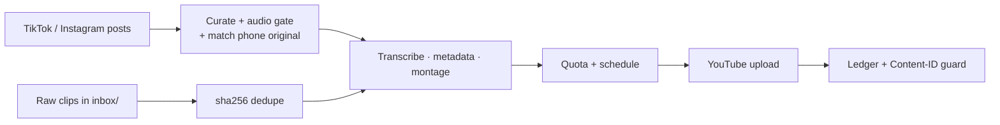

# social2shorts

Turn TikTok/Instagram reels and raw moto footage into monetization-safe YouTube Shorts.

[](https://github.com/m-elkhou/social2shorts/actions/workflows/ci.yml)
[](https://m-elkhou.github.io/social2shorts/)
[](https://www.python.org/downloads/)
[](#license)
[](https://github.com/astral-sh/ruff)



## Features

**Catalog path.** Your best TikTok and Instagram posts, ranked by engagement, deduplicated
across platforms, re-rendered from the QHD phone original instead of the 540p platform copy.
Posts with licensed music wait for your approval.

**Raw path.** Never-published clips dropped in `inbox/` become 35-second highlights: hook
first, cuts on engine revs and scene changes, karaoke captions, smart 9:16 reframing, loop
ending, -14 LUFS audio.

**Both.** Gemini-written, humanized titles. Per-video style variation. Uploads spread over days
to fit the YouTube quota, optional scheduled publishing, no duplicates, a Content-ID check after
upload, a review queue for anything uncertain.

## Quick start

Needs Python 3.12, [uv](https://docs.astral.sh/uv/) and ffmpeg.

```bash
uv sync
cp config.example.toml config.toml            # edit profiles, privacy, language
uv run social2shorts auth                     # link the YouTube channel once
uv run social2shorts run --dry-run --limit 3  # renders in work/renders/
uv run social2shorts run --limit 3            # upload 3, unlisted by default
```

Full documentation, including the Google Cloud OAuth setup and the API audit:
**<https://m-elkhou.github.io/social2shorts/>**

## Project layout

```text
src/social2shorts/
├── cli.py  config.py  models.py  ports.py
├── pipeline.py        # run loop + shared item processor
├── operations.py      # review / publish / status
├── db.py              # SQLite store + migrations
├── curate.py  match.py  phash.py  media.py  renderer.py
├── sources/           # yt-dlp catalog, phone (MTP), inbox
├── ai/                # faster-whisper, Gemini metadata
├── publish/           # YouTube, Content-ID guard, quota, scheduler
└── montage/           # probe → analyze → plan → render
tests/                 # unit (fakes) + integration (ffmpeg)
docs/                  # MkDocs Material site
scripts/               # Windows scheduled task
```

## Development

```bash
uv run pytest -q -m "not integration"
uv run ruff check . && uv run ruff format --check .
uv run --group docs mkdocs serve
```

## License

MIT
