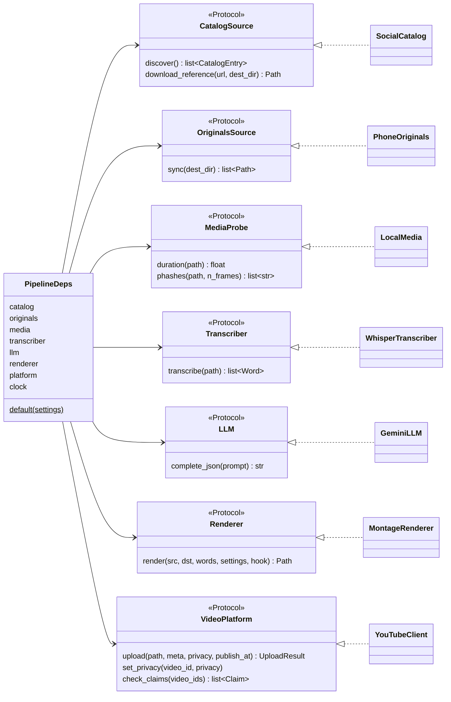
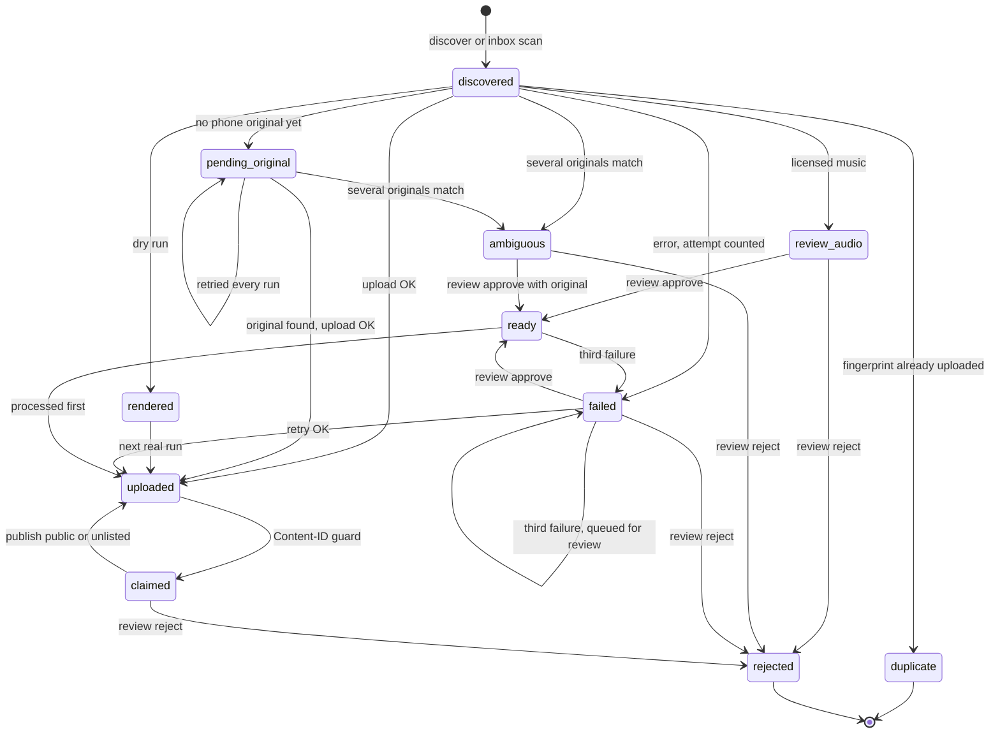
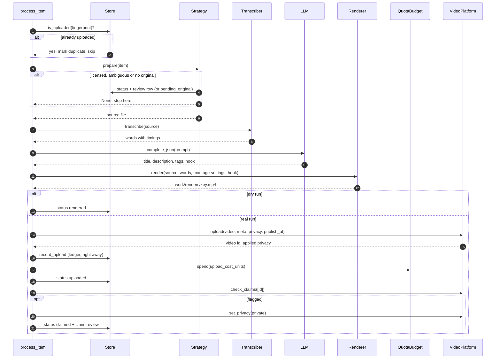
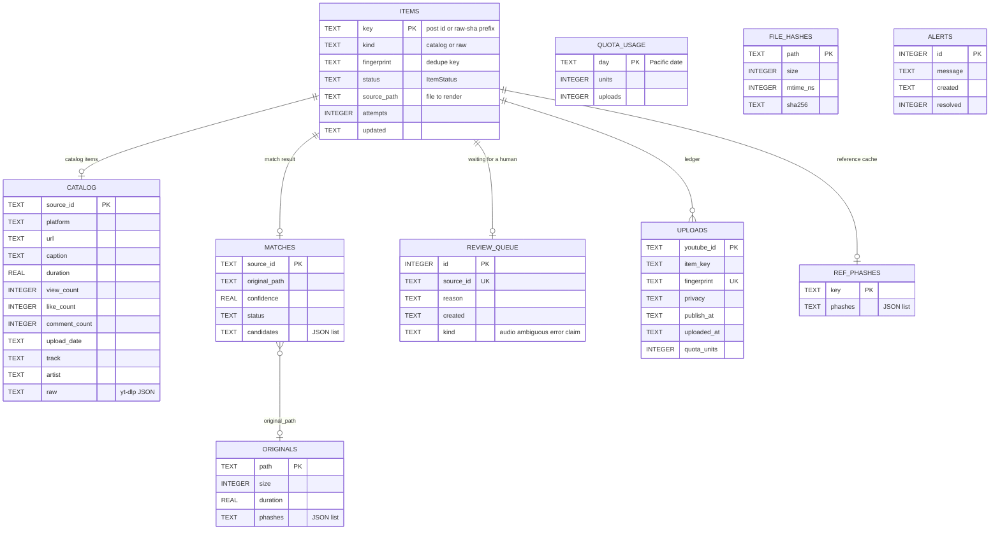

# Architecture

social2shorts is a small hexagonal application. A pipeline core works on domain models and
talks to the outside world only through ports. Adapters implement those ports for yt-dlp,
the phone, the inbox folder, faster-whisper, Gemini, the montage engine and YouTube. State
lives in one SQLite file.

## Modules

| Module | Responsibility |
|---|---|
| `cli.py` | Typer commands. Thin wrappers that load config, build adapters and print reports. |
| `config.py` | `Settings`: TOML file plus `S2S_*` environment overrides, validated by pydantic. |
| `models.py` | Domain models and enums: `Item`, `ItemStatus`, `CatalogEntry`, `ShortMeta`, `Upload`... |
| `ports.py` | `typing.Protocol` interfaces the core needs. |
| `pipeline.py` | The run loop, the two source strategies and the shared `process_item`. |
| `operations.py` | Operator actions: approve, reject, publish, status summary. |
| `db.py` | `Store`, the SQLite repository, with versioned migrations. |
| `curate.py` | Eligibility filters, engagement score, cross-platform dedupe. |
| `match.py` | Matches a post to its phone original (duration + pHash), caches originals. |
| `phash.py` | Perceptual hashes of sampled frames (PyAV + imagehash), Hamming distance. |
| `media.py` | `LocalMedia` adapter: ffprobe duration and pHashes. |
| `renderer.py` | `MontageRenderer` adapter: calls the montage engine lazily. |
| `sources/tiktok_instagram.py` | `SocialCatalog` adapter: yt-dlp discovery and 540p reference download. |
| `sources/phone.py` | `PhoneOriginals` adapter and `MtpPhoneSource` (Windows COM). |
| `sources/inbox.py` | Inbox scanner: video files keyed by sha256. |
| `ai/transcribe.py` | `WhisperTranscriber` adapter: word-level faster-whisper. |
| `ai/metadata.py` | `GeminiLLM` adapter, prompt, `humanize()`, sanitizing, fallback metadata. |
| `publish/youtube.py` | `YouTubeClient` adapter: OAuth, resumable upload with retries, privacy. |
| `publish/contentid.py` | Post-upload rights signals from `videos.list`. |
| `publish/quota.py` | `QuotaBudget`: units and uploads per Pacific day. |
| `publish/scheduler.py` | Next free `publishAt` slot. |
| `montage/` | The montage engine: probe, analyze, plan, render. See [AI montage engine](montage.md). |

## Ports and adapters

`PipelineDeps.default(settings)` builds the production adapters. Tests build `PipelineDeps`
from the fakes in `tests/fakes.py`. When `GEMINI_API_KEY` (or `GOOGLE_API_KEY`) is not set,
`llm` is `None` and metadata falls back to captions.

Inside the core, a `SourceStrategy` per `SourceKind` decides how items are found and
prepared:

| Strategy | Kind | Montage mode | refresh | candidates | prepare |
|---|---|---|---|---|---|
| `CatalogStrategy` | `catalog` | `polish` | yt-dlp discovery | approved first, then the curated shortlist | audio gate, reference pHashes, match to an original |
| `RawStrategy` | `raw` | `highlight` | inbox scan | approved first, then inbox order | the inbox file itself |

## Item lifecycle

Every video is an `Item` with an `ItemStatus` (`models.py`). These are the transitions the
code makes:

Rules behind the diagram (`pipeline._eligible`):

- A run picks up items in `discovered`, `pending_original`, `matched`, `ready`, `failed` with
  fewer than 3 attempts, and `rendered` (real runs only).
- `matched` exists in the enum and is accepted as open, but the pipeline stores match results
  in the `matches` table and never sets it on an item.
- An error on a `ready` item keeps it `ready` until the third failure.
- `reject` works on any known item, and `publish` sets `uploaded` on any item whose privacy is
  changed to public or unlisted.

## One item, step by step

Before the loop, a real run re-checks uploads from the last 3 days that are not private (or
are scheduled). Claims can appear hours after upload.

Errors:

- `AuthRefreshError` stops the run and records an alert (exit code 2).
- `QuotaExceededError` and `ScheduleFull` stop the run with a reason.
- Anything else counts a failed attempt for that item and the loop continues.
- A failed upload still spends `upload_cost_units`: YouTube may have charged it.

## Database

One SQLite file (`db_path`). The schema version is `PRAGMA user_version`; `Store.init_schema()`
applies the pending functions of `db.MIGRATIONS`, one transaction each. Version 2 is current.
There are no declared foreign keys; the relations below are logical.

| Table | Role |
|---|---|
| `items` | One row per video, whatever the source. |
| `catalog` | Post metadata from yt-dlp, joined to `items` on `key = source_id`. |
| `matches` | Last match result per post, with candidate paths for ambiguous ones. |
| `review_queue` | One row per item waiting for a decision (latest reason wins). |
| `uploads` | The anti-duplicate ledger. `fingerprint` is unique. |
| `quota_usage` | Units and `videos.insert` calls per Pacific day. |
| `originals`, `ref_phashes`, `file_hashes` | Caches: original fingerprints, reference pHashes, inbox sha256. |
| `alerts` | Operator alerts shown by `status` until `auth` resolves them. |

To change the schema, append a new `_migrate_vN(conn)` function to `MIGRATIONS`. Never edit
an existing one.

## Design patterns, and why

| Pattern | Where | Why |
|---|---|---|
| Ports and adapters | `ports.py`, `sources/`, `ai/`, `publish/`, `renderer.py` | The core is tested with fakes, no network or ffmpeg. Swapping yt-dlp or Gemini is local. |
| Strategy | `CatalogStrategy`, `RawStrategy`, `STRATEGIES` | Both paths share one processor; only "find and prepare" differs. |
| Repository | `db.Store` | All SQL in one place, one short-lived connection per operation. |
| Dependency injection | `PipelineDeps` with a `default()` factory, injectable `clock` and `sleep` | Deterministic tests for time, retries and quota days. |
| Write-ahead ledger | `_upload` records the upload before anything else | A crash after upload never causes a second upload. |
| Versioned migrations | `db.MIGRATIONS` + `PRAGMA user_version` | Old databases upgrade in place, atomically per step. |
| Retry with backoff and jitter | `publish.youtube.run_resumable` | Survives 5xx and dropped connections during long uploads. |
| Graceful fallback | `generate_metadata` | A Gemini outage never blocks an upload. |
| Lazy initialization | `YouTubeClient.service`, `functools.cache` on models, `Run.originals` | Heavy clients load only when needed; dry runs never touch OAuth. |
| Functional core | `montage/planner.py`, `montage/filters.py`, `montage/captions.py` | Pure, deterministic functions: same input, same plan and ffmpeg command. Easy to test. |
| Registry dispatch | `REFRAMES`, `CAPTION_STYLES` | Add a framing or caption style without touching callers. |
