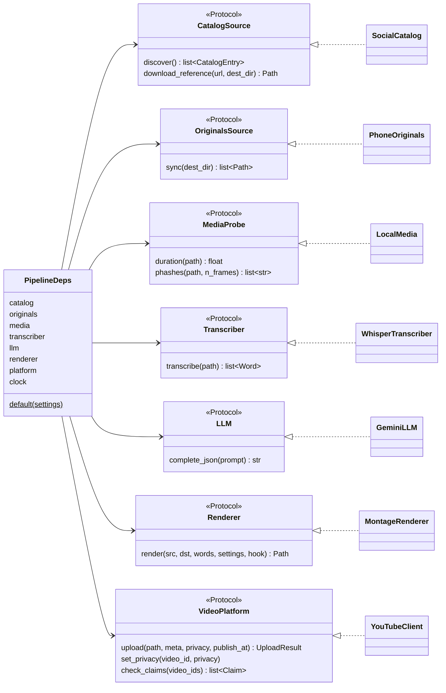
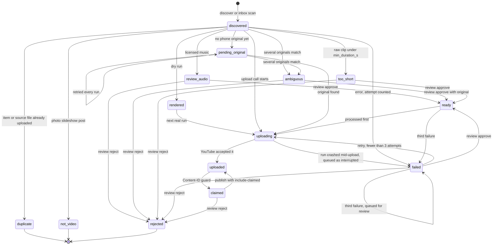
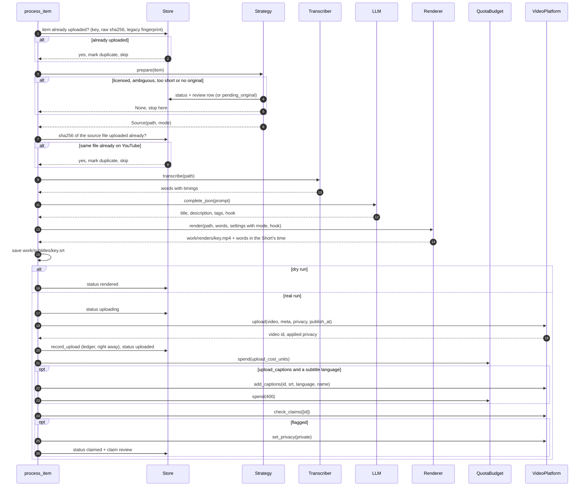
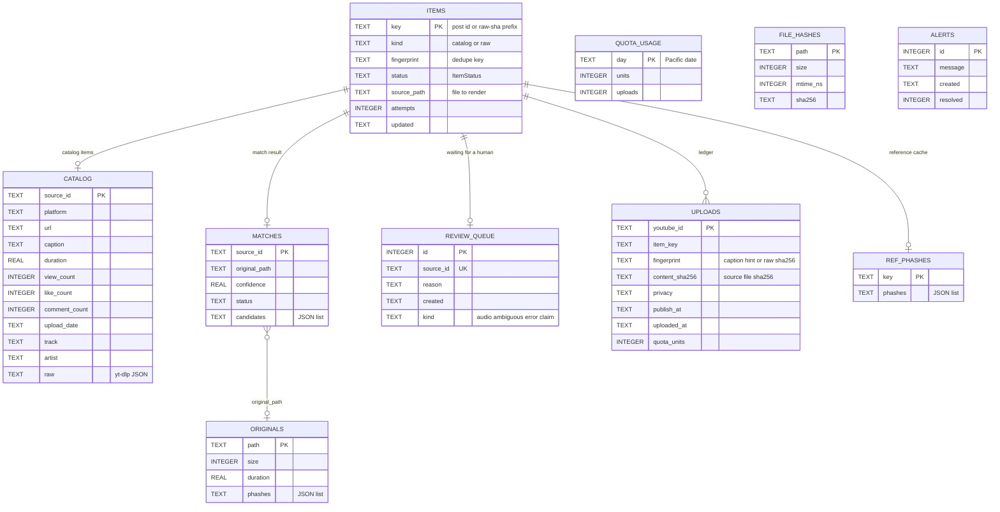

# Architecture

social2shorts is a small hexagonal application. A pipeline core works on domain models and
talks to the outside world only through ports. Adapters implement those ports for yt-dlp,
the phone, the inbox folder, faster-whisper, Gemini, the montage engine and YouTube. State
lives in one SQLite file.

## Modules

| Module | Responsibility |
|---|---|
| `cli.py` | Typer commands. Thin wrappers that load config, build adapters and print reports. |
| `config.py` | `Settings`: TOML file plus `S2S_*` environment overrides, validated by pydantic. |
| `models.py` | Domain models and enums: `Item`, `ItemStatus`, `CatalogEntry`, `ShortMeta`, `Upload`... |
| `ports.py` | `typing.Protocol` interfaces the core needs. |
| `pipeline.py` | The run loop, the two source strategies and the shared `process_item`. |
| `lock.py` | Single-instance lock (a PID file in `work_dir`) so two runs never overlap. |
| `operations.py` | Operator actions: approve, reject, publish, status summary. |
| `db.py` | `Store`, the SQLite repository, with versioned migrations. |
| `curate.py` | Eligibility filters, engagement score, cross-platform dedupe. |
| `match.py` | Matches a post to its phone original (duration + pHash), caches originals. |
| `phash.py` | Perceptual hashes of sampled frames (PyAV + imagehash), Hamming distance. |
| `media.py` | `LocalMedia` adapter (ffprobe duration, pHashes) and the cached sha256 of source files. |
| `renderer.py` | `MontageRenderer` adapter: calls the montage engine lazily. |
| `sources/tiktok_instagram.py` | `SocialCatalog` adapter: yt-dlp discovery and 540p reference download. |
| `sources/phone.py` | `PhoneOriginals` adapter and `MtpPhoneSource` (Windows COM). |
| `sources/inbox.py` | Inbox scanner: video files keyed by sha256. |
| `ai/transcribe.py` | `WhisperTranscriber` adapter: word-level faster-whisper. |
| `ai/metadata.py` | `GeminiLLM` adapter, prompt, `humanize()`, sanitizing, fallback metadata. |
| `publish/youtube.py` | `YouTubeClient` adapter: OAuth, resumable upload with retries, privacy. |
| `publish/contentid.py` | Post-upload rights signals from `videos.list`. |
| `publish/quota.py` | `QuotaBudget`: units and uploads per Pacific day. |
| `publish/scheduler.py` | Next free `publishAt` slot. |
| `montage/` | The montage engine: probe, analyze, plan, render. See [AI montage engine](montage.md). |

## Ports and adapters

`PipelineDeps.default(settings)` builds the production adapters. Tests build `PipelineDeps`
from the fakes in `tests/fakes.py`. When `GEMINI_API_KEY` (or `GOOGLE_API_KEY`) is not set,
`llm` is `None` and metadata falls back to captions.

Inside the core, a `SourceStrategy` per `SourceKind` decides how items are found and
prepared:

| Strategy | Kind | refresh | candidates | prepare returns |
|---|---|---|---|---|
| `CatalogStrategy` | `catalog` | yt-dlp discovery | approved first, then the curated shortlist | the matched phone original, mode `polish` (after the audio gate and matching) |
| `RawStrategy` | `raw` | inbox scan | approved first, then inbox order | the inbox file: mode `highlight` if longer than `[montage] target_duration_s`, else `polish`. Clips under `min_duration_s` go to review. |

`prepare` returns a `Source(path, mode)`, or `None` after routing the item to review or
`pending_original`.

## Item lifecycle

Every video is an `Item` with an `ItemStatus` (`models.py`). These are the transitions the
code makes:

Rules behind the diagram (`pipeline._eligible`):

- A run picks up items in `discovered`, `pending_original`, `matched`, `ready`, `failed` with
  fewer than 3 attempts, and `rendered` (real runs only).
- `uploading` is set just before the `videos.insert` call. If the call fails it goes back to
  the previous status. If the process dies during the call, the next run finds it still
  `uploading`, marks it `failed` with no retries left and queues an `interrupted` review: the
  video may or may not be on YouTube, so a human checks Studio.
- `matched` exists in the enum and is accepted as open, but the pipeline stores match results
  in the `matches` table and never sets it on an item.
- An error on a `ready` item keeps it `ready` until the third failure.
- `reject` works on any known item, and `publish` sets `uploaded` on any item whose privacy is
  changed to public or unlisted.

## One item, step by step

Before the loop, a run takes the lock, recovers items left `uploading` by a crashed run, and
(real runs only) re-checks uploads from the last 3 days that are not private or are scheduled.
Claims can appear hours after upload.

Errors:

- `AuthRefreshError` stops the run and records an alert (exit code 2).
- `QuotaExceededError` and `ScheduleFull` stop the run with a reason. YouTube's daily quota
  (403) and the channel's upload limit (`uploadLimitExceeded`, 400) both raise
  `QuotaExceededError`; no item is charged an attempt. The stop reason says which one it was:
  the upload limit does not show in the API quota.
- The upload limit (about 10 uploads) counts the last 24 hours, not a Pacific day: on
  2026-11-01 it still refused uploads 4 and 8.5 hours after the previous batch, across a quota
  reset. So a refusal does not mark the quota day spent; it is stored in `upload_limit`, and
  later runs stop before any render or Gemini call until every upload of the 24 hours before
  the refusal is 24 hours old (`upload_limit_until`). `status` shows when that is.
- `LLMQuotaExceeded` (Gemini's per-day 429; the free tier allows 20 requests per model per
  day) stops the run too, rather than publish videos with template titles and uncorrected
  subtitles. Temporary Gemini errors (408, 500, 502, 503 "high demand", 504) are retried for
  about a minute first; after that, and for any other Gemini error, the item falls back
  (template metadata, speech-model draft).
- A catalog post whose reference has no video stream (a TikTok photo slideshow comes down as
  audio) becomes `not_video` and is never retried.
- Anything else is an item failure, with one exception: if **3 items in a row fail with the
  same error** (`SYSTEMIC_FAILURES`), it is treated as a system fault (no network, a model
  download failed...). The run stops, records an alert, and no item is charged an attempt.
  Otherwise each failure counts one attempt for its item and the loop continues.
- A failed upload call still spends `upload_cost_units`: YouTube may have charged it.
- Once YouTube accepted a video, nothing is retried. If the ledger write itself fails, the run
  logs a critical message and records an alert with the video link. If adding the subtitle
  track fails, the run records an alert that names the saved SRT to upload in YouTube Studio.
- A second run started while one holds `work_dir/social2shorts.lock` does nothing and reports
  "another run (pid N) has been working for M min". A lock older than 6 hours is treated as
  stale and replaced.

## Database

One SQLite file (`db_path`). The schema version is `PRAGMA user_version`; `Store.init_schema()`
applies the pending functions of `db.MIGRATIONS`, one transaction each. Version 3 is current:
it added `uploads.content_sha256` (the real dedupe key), stored timestamps as ISO UTC, and
mapped legacy Content-ID reviews to claims.
There are no declared foreign keys; the relations below are logical.

| Table | Role |
|---|---|
| `items` | One row per video, whatever the source. |
| `catalog` | Post metadata from yt-dlp, joined to `items` on `key = source_id`. |
| `matches` | Last match result per post, with candidate paths for ambiguous ones. |
| `review_queue` | One row per item waiting for a decision (latest reason wins). |
| `uploads` | The anti-duplicate ledger. Checked by item key, by source-file sha256, and by caption fingerprint for pre-v3 rows. |
| `quota_usage` | Units and `videos.insert` calls per Pacific day. |
| `upload_limit` | When YouTube last refused an upload with `uploadLimitExceeded` (one row). |
| `originals`, `ref_phashes`, `file_hashes` | Caches: original fingerprints, reference pHashes, sha256 of source files (by path, size and mtime). |
| `alerts` | Operator alerts shown by `status` until `auth` resolves them. |

To change the schema, append a new `_migrate_vN(conn)` function to `MIGRATIONS`. Never edit
an existing one.

## Design patterns, and why

| Pattern | Where | Why |
|---|---|---|
| Ports and adapters | `ports.py`, `sources/`, `ai/`, `publish/`, `renderer.py` | The core is tested with fakes, no network or ffmpeg. Swapping yt-dlp or Gemini is local. |
| Strategy | `CatalogStrategy`, `RawStrategy`, `STRATEGIES` | Both paths share one processor; only "find and prepare" differs. |
| Repository | `db.Store` | All SQL in one place, one short-lived connection per operation. |
| Dependency injection | `PipelineDeps` with a `default()` factory, injectable `clock` and `sleep` | Deterministic tests for time, retries and quota days. |
| Write-ahead ledger | `uploading` status before the call, ledger row right after it | A crash after upload never causes a second upload; a crash during it goes to a human. |
| Single-instance lock | `lock.single_instance` | A manual run and a scheduled run never upload at the same time. |
| Circuit breaker | `FailureStreak` | A system-wide fault stops the run instead of burning every item's retries. |
| Versioned migrations | `db.MIGRATIONS` + `PRAGMA user_version` | Old databases upgrade in place, atomically per step. |
| Retry with backoff and jitter | `publish.youtube.run_resumable` | Survives 5xx and dropped connections during long uploads. |
| Graceful fallback | `generate_metadata` | A Gemini outage never blocks an upload. |
| Lazy initialization | `YouTubeClient.service`, `functools.cache` on models, `Run.originals` | Heavy clients load only when needed; dry runs never touch OAuth. |
| Functional core | `montage/planner.py`, `montage/filters.py`, `montage/captions.py` | Pure, deterministic functions: same input, same plan and ffmpeg command. Easy to test. |
| Registry dispatch | `REFRAMES`, `CAPTION_STYLES` | Add a framing or caption style without touching callers. |
