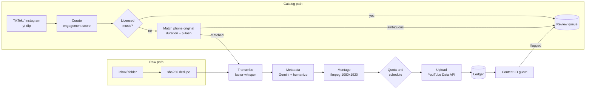

# social2shorts

**social2shorts** turns moto videos into YouTube Shorts. It re-renders your best TikTok and
Instagram posts from the phone originals, cuts never-published raw clips into Shorts with an
automatic montage engine, and uploads everything within the YouTube API quota, without
duplicates and with rights checks before and after upload.

## Two paths, one processor

| Path | Input | What happens |
|---|---|---|
| **Catalog** | Posts already on TikTok / Instagram | Ranked by engagement, matched to the QHD phone original, polished (reframe, captions, loudness) and uploaded. |
| **Raw** | Video files dropped in `inbox/` | Analysed, cut into a 35-second highlight with a hook, captions and a loop ending, then uploaded. |

Both paths share the same item processor: transcribe, write metadata, render, check quota,
upload, record, guard.



## Quick start

```bash
uv sync                                       # install
cp config.example.toml config.toml            # then edit it
uv run social2shorts auth                     # link the YouTube channel once
uv run social2shorts run --dry-run --limit 3  # render 3 Shorts to work/renders/
uv run social2shorts run --limit 3            # upload 3 (unlisted by default)
```

Before the first real upload, read [Getting started](getting-started.md): you need a Google
Cloud OAuth client, and unaudited API projects can only upload private videos.

## Where to go next

- **[Getting started](getting-started.md)**: install, configure, connect YouTube and Gemini.
- **[Use cases](use-cases/index.md)**: the exact commands for each job.
- **[Architecture](architecture.md)**: modules, ports and adapters, item lifecycle, database.
- **[AI montage engine](montage.md)**: how a raw clip becomes a Short.
- **[YouTube safety](youtube-safety.md)**: what protects the channel, and what doesn't.
- **[Configuration](configuration.md)** and **[CLI](cli.md)** reference.
