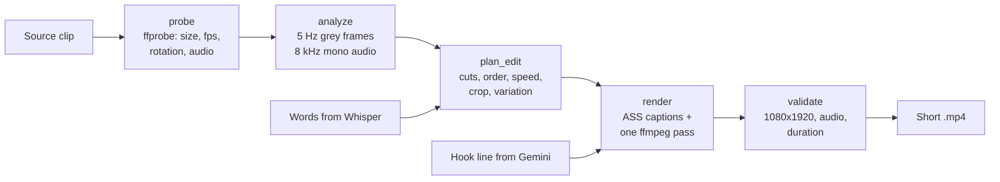
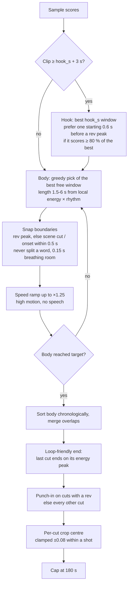
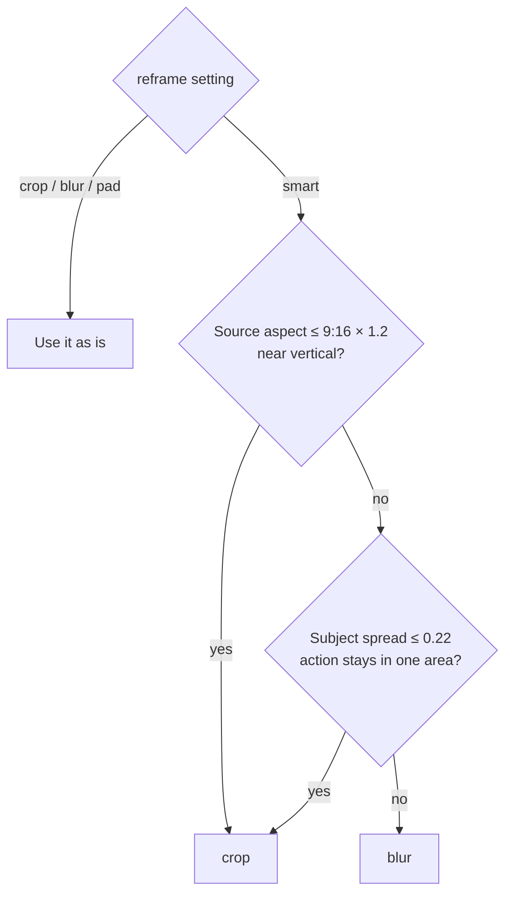
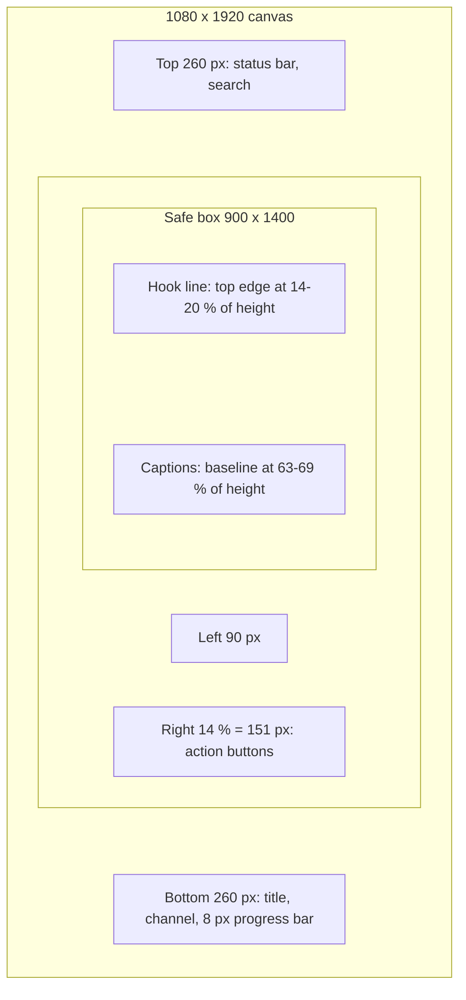

# AI montage engine

`social2shorts.montage` turns a source clip into a finished 1080×1920 Short in one ffmpeg
pass. It needs no GPU and no ML model of its own: the "AI" is signal analysis plus a planner
with explicit, testable heuristics. The transcript (faster-whisper) and the hook line
(Gemini) come in from the pipeline.

```python
from social2shorts.montage import MontageSettings, make_short

result = make_short("inbox/ride.mp4", "out.mp4", words=[], settings=MontageSettings())
print(result.duration, [c.reason for c in result.plan.cuts])
```

## Pipeline



| Step | Module | Output |
|---|---|---|
| probe | `probe.py` | `MediaInfo`: displayed width/height (after rotation), fps, duration, has_audio. |
| analyze | `analyze.py` | `Analysis`: per-sample motion, brightness, loudness, speech, subject position, scene cuts, audio onsets, rev envelope and rev peaks. |
| plan | `planner.py`, `style.py` | `EditPlan`: cuts in output order with speed, zoom, crop; framing; variation; loop crossfade. Every cut carries a human-readable `reason`. |
| render | `captions.py`, `filters.py`, `render.py` | ASS file, filter graph, ffmpeg command, validated `RenderResult`. |

Any failure raises `MontageError` with the tail of ffmpeg's stderr.

## Two modes

| Mode | Used for | What the planner does |
|---|---|---|
| `polish` | Catalog posts (already edited) | Keeps the whole clip. Trims a dead head or tail (static, silent, no speech) of 0.5 s or more. Caps at 180 s. No hook cut, no punch-in, no loop. |
| `highlight` | Raw inbox footage | Picks the best moments, hook first, re-cuts to `target_duration_s`, punch-ins, loop ending. |

The pipeline sets the mode per source kind. The `[montage] mode` key is overridden there.

## Analysis signals

The clip is decoded once at `SAMPLE_HZ = 5` frames per second, downscaled to 96 px wide
grayscale, plus mono audio at 8 kHz.

| Signal | How | Constant |
|---|---|---|
| Motion | Mean absolute frame difference | |
| Brightness | Mean luma | |
| Scene cuts | 32-bin histogram distance above 0.35 **and** 3× the clip's median change | `SCENE_HIST_MIN`, `SCENE_MEDIAN_RATIO` |
| Loudness | RMS per sample, -60 dBFS → 0, 0 dBFS → 1 | `SILENCE_DB` |
| Audio onsets | Local maxima of the loudness rise ≥ 0.08 | |
| Speech | Fraction of each sample covered by transcript words | |
| Subject x | Centre of visual energy: 70 % motion, 30 % edges | `SUBJECT_MOTION_WEIGHT` |
| Rev envelope | Positive spectral flux in 80–2000 Hz (256-sample FFT, 50 % overlap), scaled per clip p10–p95 | `REV_BAND_HZ`, `REV_FRAME`, `REV_HOP` |
| Rev peaks | Rev ≥ 0.6, at least 1.5 s apart | `REV_PEAK_MIN`, `REV_PEAK_GAP_S` |

A throttle blip makes the engine harmonics jump in level and pitch, which shows up as a burst
of in-band flux. Steady cruising and wind stay near the floor.

## Scoring

Each sample gets an interest score. Signals are normalized within the clip (p0–p95; loudness
p10–p95), so a quiet night clip is judged against itself.

```text
score = 0.45 × motion + 0.30 × loudness + 0.25 × speech + 0.10 × rev
      - 0.30 × static - 0.20 × dark
```

| Weight | Value | Meaning |
|---|---|---|
| `W_MOTION` | 0.45 | Visual action drives retention for riding footage. |
| `W_AUDIO` | 0.30 | Engine revs and loud moments. |
| `W_SPEECH` | 0.25 | The rider talking to camera. |
| `W_REV` | 0.10 | Extra bonus for revs (they also drive the hook, cuts and zooms). |
| `P_STATIC` | 0.30 | Penalty when normalized motion < 0.08 (parked, phone on the ground). |
| `P_DARK` | 0.20 | Penalty scaled by how far mean luma is below 0.06 (pocket, tunnel). |

The score is smoothed over about 1 s.

## Highlight plan



- **Hook.** The best `hook_s` window (2 s) is played first, then the body. A window starting
  0.6 s before a rev peak wins if it scores at least 80 % of the best window, so the build-up
  is heard.
- **Rhythm.** Segment length goes from 6 s (calm) down to 1.5 s (high energy), multiplied by
  the per-video `rhythm`.
- **Snapping.** Cut points move to a rev peak first, else to a scene cut or audio onset within
  0.5 s. They are then pushed out of any spoken word, keeping 0.15 s of breathing room.
- **Speed ramps.** A speechless stretch (speech density ≤ 0.05) with normalized motion above
  0.6 is sped up, by 0.05 steps, up to ×1.25. If the result is shorter than `min_duration_s`,
  ramps are removed.
- **Loop ending.** The last segment is shortened to end on its energy peak (second half), if it
  stays ≥ 1.5 s and the Short stays ≥ `min_duration_s`. The render then crossfades the last
  0.3 s into the opening frame, so the replay is seamless. Replays count as views on Shorts.
- **Punch-in.** Cuts containing a rev peak get a smooth zoom from 1.0 to the per-video
  `punch_zoom` (1.05–1.10). Without revs, every other cut zooms, starting with the opener.

## Reframing

| Mode | Result |
|---|---|
| `crop` | Stationary 9:16 crop centred on the cut's subject position, then scaled. |
| `blur` | The whole frame fitted on top of a blurred, darkened copy of itself. |
| `pad` | The whole frame fitted, black bars. |
| `smart` (default) | Chooses `crop` or `blur` per clip, see below. |



Crops are AutoFlip-style: one stationary centre per cut, the median of the smoothed subject
position over that cut. Between two cuts of the same shot the centre moves by at most 0.08 of
the frame width, so the framing doesn't jump.

## Captions and safe zone

Captions are an ASS file burned in by ffmpeg's `ass` filter. Layout constants are defined on a
1080×1920 canvas and scaled to the output size.

| Style | Look |
|---|---|
| `karaoke` | 1–3 uppercase words on screen (≤ 16 characters); the word being spoken is in the accent colour; each cue pops in. A new cue starts on a 0.45 s pause or after punctuation. |
| `minimal` | Plain phrases of up to 7 words / 34 characters, smaller (62 % size). |
| `none` | No captions. |

The **hook** line (from Gemini, ≤ 40 characters) shows for the first 2.5 s in the upper part,
in a semi-opaque box, with a fade and pop. It needs `hook_text = true` and an LLM hook.



- Safe box: 900×1400 centred, so 90 px left/right and 260 px top/bottom on 1080×1920.
- The right margin is the larger of the box margin and 14 % of the width: the like and share
  buttons sit there.
- Caption baseline sits at `caption_y` (63–69 % of the height) but never below the box.
- The hook's top edge sits at `hook_y` (14–20 %) but never above the box.

## Per-video variation

YouTube's "inauthentic content" policy (renamed from "repetitious content" in July 2025)
targets channels whose videos look "made with a template with little to no variation", and it
applies to the whole channel. 200 Shorts with the same colours, rhythm and layout are exactly
that. So each source gets its own style, drawn from a seed:

| Knob | Range |
|---|---|
| Caption accent colour | one of 6: yellow, lime, cyan, orange, hot pink, white-gold |
| Caption baseline | 63–69 % of the height |
| Hook top edge | 14–20 % of the height |
| Cutting rhythm | ×0.85 to ×1.15 segment length |
| Punch-in zoom | 1.05 to 1.10 |
| Music track | one file of `music_dir` |

The seed is a sha256 of the file size plus its first 1 MB. Two clips with the same name get
different styles, a renamed copy keeps its style, and re-renders are reproducible. An explicit
`caption_highlight` in the config overrides the accent palette.

Metadata varies too: Gemini writes from each video's own caption and transcript, and the
call-to-action line and fallback titles are picked per item key. See
[YouTube safety](youtube-safety.md).

## Look and audio

- **Grade** (`color_grade`): light denoise, contrast ×1.06, saturation ×1.15, gamma 1.04 to
  lift night shadows, mild sharpening.
- **Fades**: `fade_s` (0.2 s) in and out, unless the Short loops: a loop must not dip to black.
- **Progress bar**: an accent-coloured line at the bottom, 8 px high on 1080×1920.
- **Loudness**: `loudnorm` to `loudness_lufs` (-14 LUFS, the YouTube playback reference),
  true peak -1.5 dBTP, LRA 11.
- **Clicks**: a 15 ms fade at every cut.
- **Music** (optional): one track from `music_dir`, looped, at `music_volume_db` (-20 dB), and
  ducked under the original sound with a sidechain compressor (threshold 0.03, ratio 8,
  attack 20 ms, release 400 ms). The engine and voice stay in front.
- **Silent sources** get a silent stereo track, so every Short has audio.
- **Encode**: H.264 High, `crf` 18, `preset` slow, yuv420p, GOP of 2 s, AAC 192 kb/s 48 kHz
  stereo, `+faststart`.

After rendering, the output is probed. A wrong size or a missing audio track raises
`MontageError`; a duration off by more than 0.5 s (or 3 %) logs a warning.

## `[montage]` settings

| Key | Type | Default | Description |
|---|---|---|---|
| `mode` | `polish` \| `highlight` | `highlight` | Overridden by the pipeline per source kind. |
| `width` | int | `1080` | Output width. |
| `height` | int | `1920` | Output height. |
| `fps` | int | `30` | Output frame rate. |
| `target_duration_s` | float, 0 < x ≤ 180 | `35.0` | Highlight length to aim for. |
| `min_duration_s` | float > 0 | `12.0` | Highlight floor (loop trim and speed ramps respect it). |
| `hook_s` | float | `2.0` | Length of the hook cut pulled to the front. `0` disables it. |
| `reframe` | `smart` \| `blur` \| `crop` \| `pad` | `smart` | Framing, see above. |
| `captions` | `karaoke` \| `minimal` \| `none` | `karaoke` | Caption style. |
| `caption_font` | str | `Arial Black` | Font name passed to libass. Must be installed. |
| `caption_size` | int | `88` | Caption size on a 1080-wide frame. |
| `caption_highlight` | str | `&H0000E5FF` | Accent in ASS `&HAABBGGRR`. Setting it disables the palette. |
| `hook_text` | bool | `true` | Show the LLM hook line for the first 2.5 s. |
| `loudness_lufs` | float | `-14.0` | Integrated loudness target. |
| `color_grade` | bool | `true` | Apply the grade. |
| `punch_in` | bool | `true` | Zoom on rev cuts (highlight mode). |
| `progress_bar` | bool | `true` | Draw the progress bar. |
| `fade_s` | float | `0.2` | Fade in/out length (skipped for loops). |
| `music_dir` | str \| null | `null` | Folder of royalty-free tracks (`.mp3 .m4a .aac .wav .flac .ogg .opus`). |
| `music_volume_db` | float | `-20.0` | Music level before ducking. |
| `crf` | int | `18` | x264 quality (lower = better, bigger). |
| `preset` | str | `slow` | x264 preset. `veryfast` for quick previews. |

!!! warning "Music and long Shorts"
    A Short longer than 60 s with any Content ID claim is blocked worldwide. Put only
    claim-free tracks in `music_dir`, and keep `target_duration_s` under 60 when you use music.
    Polish mode keeps the original length (up to 180 s), so be careful with music on catalog
    posts.
