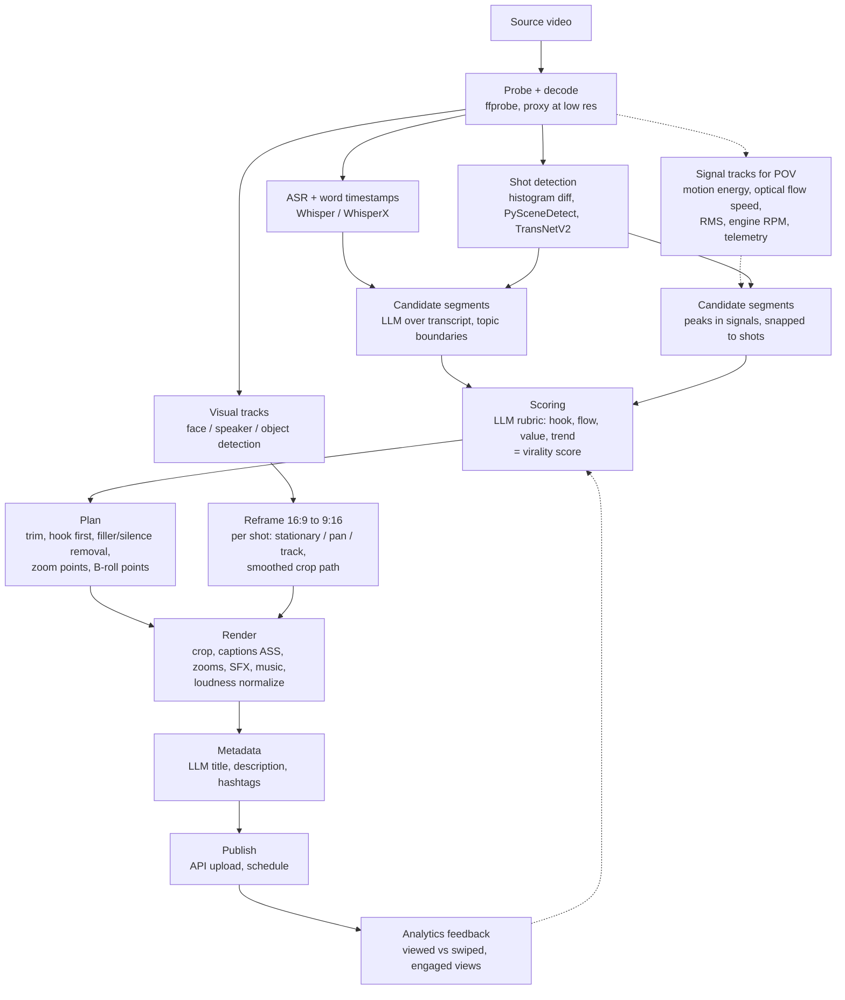

# State of the art: automatic short-form editing (research notes, October 2026)

Scope: what existing tools and techniques do the same job as `social2shorts` (raw clips and finished reels into YouTube Shorts), how they work technically, and what we should adopt, copy, or skip. Written for the engine as it is today: probe → analyze → plan → render → upload, built on ffmpeg, faster-whisper, Gemini and the YouTube Data API v3.

Sourcing notes:

- Most information about commercial tools comes from their own marketing pages or from competitors' comparison pages. None of them publish their algorithms. Where I describe how a commercial tool works, that's either what the vendor says or my inference, and I label it.
- Several Google pages (developers.google.com, support.google.com, ai.google.dev) couldn't be fetched directly from this environment. Their content is cited through search-result excerpts and secondary coverage. Re-check those facts against the live pages before relying on them for anything costly (quota planning, policy compliance).
- "Unverified" means I found only one source, or only a vendor source.

---

## 1. Executive summary

1. **Commercial clippers are built for talking heads.** They all follow the same pattern: transcribe, have an LLM pick and score segments from the transcript, reframe on the active speaker, burn in animated word-level captions, then add zooms, B-roll and SFX. OpusClip, Vizard, Klap, Submagic and Munch all work this way. Our material is mostly night-riding POV with engine sound and little speech, which breaks that design. Their transcript-driven segment picking and speaker tracking are mostly irrelevant to us. Their *finishing layer* (captions, zooms, SFX, hook text, loudness) is the part worth matching.
2. **The "virality score" is not magic.** OpusClip's own help page says its 0–99 score weighs four things: hook, flow with a satisfying ending, value or emotional resonance, and trend alignment ([OpusClip help](https://help.opus.pro/docs/article/virality-score)). No vendor publishes weights or validation. In practice it's an LLM rubric. We can build the same thing with Gemini plus our own signal features, and calibrate it against our own channel analytics, which the vendors can't do.
3. **For our footage, the best moment detector is signal-based, with a multimodal LLM as the judge.** We should use motion energy, optical-flow speed, engine-RPM and loudness peaks, and scene cuts to propose candidates, then let Gemini (which samples video at 1 fps by default, about 300 tokens/s at default resolution per [secondary analysis](https://www.s-anand.net/blog/how-does-gemini-process-videos/)) rank them and write hooks. This hybrid is cheaper and more controllable than sending whole raw clips to an LLM.
4. **Open source has good building blocks but no complete answer.** PySceneDetect (BSD-3), TransNetV2 (MIT), faster-whisper/WhisperX, MediaPipe and open_clip are worth using. End-to-end "OpusClip clones" on GitHub (ClipsAI, AI-Youtube-Shorts-Generator and others) are transcript-plus-GPT glue code aimed at podcasts. Copy the ideas, don't depend on them. Google AutoFlip is still in the MediaPipe repo but needs Bazel and OpenCV 3 ([repo](https://github.com/google-ai-edge/mediapipe/tree/master/mediapipe/examples/desktop/autoflip)). Copy its design (shot-level camera modes: stationary, pan, track) instead.
5. **Policy and quota are the real constraints on 200 uploads.**
   - YouTube's "inauthentic content" policy (renamed from "repetitious content" on 15 July 2025) explicitly targets content "made with a template with little to no variation across videos", and it applies to the whole channel ([SEJ](https://www.searchenginejournal.com/youtube-clarifies-monetization-update-targeting-spam-not-reaction-channels/550755/), [Social Media Today](https://www.socialmediatoday.com/news/youtube-clarifies-monetization-update-inauthentic-repeated-content/752892/)). An automated pipeline that stamps the same hook style, same music and same structure on 200 videos is exactly what this wording describes. Variation has to be designed in.
   - Since 1 June 2026, `videos.insert` has its own quota bucket, with a default of **100 calls/day** ([Revision history, via search](https://developers.google.com/youtube/data/revision_history), [bundle.social](https://bundle.social/blog/youtube-api-quota-exceeded-limits-fixes)).
   - Uploads from unaudited API projects are locked to private ([videos.insert docs](https://developers.google.com/youtube/v3/docs/videos/insert)). We need to pass the compliance audit before public or scheduled publishing works through the API.
6. **Music above 60 s is dangerous.** A Short longer than 1 minute with *any* active Content ID claim is blocked worldwide ([YouTube Help: three-minute Shorts](https://support.google.com/youtube/answer/15424877?hl=en)). Keep music-backed Shorts at 60 s or less, or use only claim-free music.

---

## 2. Comparison table

### 2.1 Commercial tools

| Tool | Main input it's designed for | Moment selection | Score | Reframe | Captions | Extras | What's known technically |
|---|---|---|---|---|---|---|---|
| **OpusClip** | Long talking videos (podcasts, webinars) | Transcript + "visual, audio, and sentiment cues"; ClipAnything mode takes a text prompt ([help](https://help.opus.pro/docs/article/virality-score)) | 0–99 virality score: hook, flow, value, trend ([help](https://help.opus.pro/docs/article/virality-score)) | ReframeAnything: tracks speakers and moving objects such as a ball ([vendor](https://www.opus.pro/ai-reframe)) | Animated, about 97% accuracy claimed (vendor) | AI B-roll, filler and pause removal, brand templates ([CB Insights](https://www.cbinsights.com/compare/munch-4-vs-opus-clip)) | Algorithm unpublished. A hands-on review says about 40% of clips get discarded ([BigVU](https://bigvu.tv/blog/opus-clip-tested-2026-where-ai-wins-40-percent-discard/)) |
| **Vizard** | Long talking videos | AI finds "most engaging moments" | Viral score | Active speaker detection ([VEED comparison](https://www.veed.io/learn/veed-vs-vizard)) | Auto subtitles, 100+ languages | Translation | Unpublished |
| **Klap** | Long talking videos | Transcript-based (assumed) | Virality score ([Submagic table](https://www.submagic.co/alternatives/klap), competitor source) | Speaker reframe, split screen | 52 languages (vendor) | 4K export | Unpublished |
| **Submagic** | Already-cut short videos | Not a clipper first; it's a finisher | n/a | n/a | Its core product: animated word captions, emojis, keyword highlight | "Magic Zooms" in 6 styles timed to spoken words ([vendor](https://submagic.co/features/auto-zooms)), auto B-roll from stock, SFX on transitions ([vendor](https://submagic.co/features/b-rolls)), silence and filler removal, music | Zooms and B-roll keyed to transcript words (vendor statement) |
| **Munch** | Long videos | Transcript + "trend" data | Yes | Yes | Yes | Posting-time advice ([CB Insights](https://www.cbinsights.com/compare/munch-4-vs-opus-clip)) | Unpublished |
| **CapCut AutoCut** | Raw clips + a music track or script | Cuts on speech, music beats or on-screen text, removes dialogue-free and "low-value" parts, detects scene changes ([CapCut help](https://www.capcut.com/help/auto-cut-in-capcut)) | n/a | Auto reframe exists in CapCut | Auto captions, many templates | Beat sync, templates | Vendor descriptions only |
| **Descript** | Speech (podcasts, explainers) | Text-based editing: delete words in the transcript and the video is cut ([CapCut roundup](https://www.capcut.com/resource/top-7-autocut-tools-for-long-videos), competitor source) | n/a | Layouts | Yes | Filler and silence removal, AI agent ("Underlord") | Transcript-to-timeline mapping |
| **Captions.ai / VEED / 2short.ai** | Talking heads / general editing / YouTube long-form | Similar LLM + transcript pattern | Some | Speaker | Yes | VEED: stock library, avatars, voice cloning ([VEED](https://www.veed.io/learn/veed-vs-vizard)) | Couldn't find technical detail for Captions.ai or 2short.ai in this pass |

None of these is designed for long stretches of footage without speech, where the "content" is speed, lights and engine sound. For them, a night ride is a transcript with a few words in it.

### 2.2 Open-source building blocks

| Project | What it does | License | Maturity | Verdict for us |
|---|---|---|---|---|
| [PySceneDetect](https://pypi.org/project/scenedetect/) | Shot detection (content, adaptive, threshold detectors) | BSD-3 ([license](https://scenedetect.com/copyright)) | Stable, v0.6.6 March 2025 | **Adopt** if our own scene-cut code falls short. Cheap, pure Python + OpenCV |
| [TransNetV2](https://github.com/soCzech/TransNetV2) | Neural shot-boundary detection, catches soft transitions | MIT (per [HF weights card](https://huggingface.co/magnusdtd/TransNetV2/blob/main/README.md)) | Research code, but widely used | **Optional adopt** for the *edited* reels, which have dissolves and transitions. Overkill for raw POV |
| [auto-editor](https://github.com/WyattBlue/auto-editor) | Cuts dead space by audio loudness and/or motion, exports to NLEs | Unlicense (public domain) | Mature; now written in Nim | **Copy the idea** (thresholds, margins, `or` combinations). Not a Python library any more |
| [faster-whisper](https://github.com/SYSTRAN/faster-whisper) | CTranslate2 Whisper with word timestamps | MIT (my knowledge, verify) | Mature | **Keep** (already used) |
| [WhisperX](https://github.com/m-bain/whisperX) | faster-whisper + wav2vec2 forced alignment + pyannote diarization ([Modal](https://modal.com/blog/choosing-whisper-variants)) | BSD-2 (my knowledge, verify) | Mature, heavier | **Consider** only if karaoke timing drifts. Alignment models exist for FR and EN; Arabic support should be checked |
| [ClipsAI](https://github.com/ClipsAI/clipsai) | Transcript-based clip finding + speaker-focused 16:9 to 9:16 resize (pyannote) | MIT | About 555 stars, small; aimed at podcasts | **Skip** as a dependency. Its speaker-centric reframe doesn't fit POV |
| [AI-Youtube-Shorts-Generator](https://github.com/SamurAIGPT/AI-Youtube-Shorts-Generator) and forks, OpenShorts, yt-short-clipper | Whisper + GPT picks highlight + face crop + subtitles | Mostly MIT | Hobby/v0.x quality | **Skip**. Useful only to read prompts |
| [MediaPipe](https://github.com/google-ai-edge/mediapipe) (incl. AutoFlip) | Face/pose/object detection; AutoFlip = saliency-aware reframing | Apache-2.0 | MediaPipe Tasks: mature. AutoFlip: old, Bazel + OpenCV 3 only ([README](https://github.com/google-ai-edge/mediapipe/tree/master/mediapipe/examples/desktop/autoflip)) | **Copy AutoFlip's design.** Use MediaPipe face detection only for clips where the rider talks to camera |
| [Moment-DETR / QVHighlights](https://github.com/jayleicn/moment_detr), [SG-DETR](https://arxiv.org/html/2410.01615v1) | Query-based moment retrieval + clip saliency scores on CLIP/SlowFast features | Code is open. QVHighlights dataset is non-commercial, I believe; verify | Research | **Skip.** Trained on vlog/news-style data. The *idea* (text query vs. CLIP features) is cheap to copy with open_clip |
| [open_clip](https://github.com/mlfoundations/open_clip) | Image-text embeddings | MIT (my knowledge) | Mature | **Optional adopt** for cheap local frame scoring ("city lights at night", "highway at speed") |
| GoPro GPMF parsers ([gpmf](https://pypi.org/project/gpmf), [pygpmf_oz](https://pygpmf-oz.readthedocs.io), [gopro-telemetry](https://npmjs.com/package/gopro-telemetry)) | Read GPS speed, gyro (~400 Hz), accelerometer (~200 Hz) from GoPro MP4s ([jin-zhe/gopro](https://github.com/jin-zhe/gopro)) | MIT / various | Small but working | **Adopt** if the creator shoots on GoPro. Real speed and lean data beats anything inferred from pixels |

---

## 3. How it works

### 3.1 A typical AI clipping pipeline

This is the shared design behind OpusClip, Vizard, Klap and the open-source clones, assembled from the vendor descriptions above. The dashed branch is what we need for footage without speech.

The feedback edge (M to G) is the one the commercial tools *don't* close per creator. OpusClip's score is the same model for every creator, with no personalization ([BigVU review](https://bigvu.tv/blog/opus-clip-tested-2026-where-ai-wins-40-percent-discard/)). Closing that loop is our biggest structural advantage.

### 3.2 Commercial tools: what they actually do

**Segment picking.** Every clipper described here starts from the transcript. OpusClip says ClipAnything also uses "visual, audio, and sentiment cues" and accepts natural-language prompts ([help](https://help.opus.pro/docs/article/virality-score)). The likely implementation (my inference) is a multimodal LLM over frame samples plus the transcript, similar to Gemini's video input. ClipsAI, the one open project that documents itself, finds clips from the transcript alone and needs word timestamps from WhisperX ([repo](https://github.com/ClipsAI/clipsai)).

**Virality scoring.** OpusClip's documented criteria are hook, coherent flow with a satisfying end, value or emotional resonance, and trend alignment, plus prompt relevance in ClipAnything mode ([help](https://help.opus.pro/docs/article/virality-score)). There's no published validation. Independent testers treat it as a ranking aid, not a predictor ([thecmo](https://thecmo.com/tools/opusclip-review/), [BigVU](https://bigvu.tv/blog/opus-clip-tested-2026-where-ai-wins-40-percent-discard/)). An LLM rubric with fixed criteria, returning a number and a reason, gets you most of the way there.

**Reframing.** Speaker-centric: face detection, active-speaker detection (lip motion and audio correlation, or diarization as in ClipsAI's pyannote approach), then a smoothed crop window that follows the speaker. OpusClip's ReframeAnything extends this to tracked objects ([vendor](https://www.opus.pro/ai-reframe)). The open reference design is AutoFlip ([Google Research blog, 2020](https://research.google/blog/autoflip-an-open-source-framework-for-intelligent-video-reframing/)):
1. Detect shots by comparing colour histograms against a sliding window of recent frames.
2. Buffer each whole shot and run saliency detectors on it (faces, people, animals, text, logos, motion).
3. Choose a camera mode per shot: **stationary**, **panning** (constant velocity) or **tracking**.
4. Solve a crop path for that mode.

The key idea: decide the camera behaviour per shot *after* seeing the whole shot, instead of reacting frame by frame. That's what keeps the crop from jittering.

**Captions.** Word-by-word animated captions are standard everywhere. "Hormozi style" is usually described as heavy sans-serif (Montserrat Black 900 is the usual recipe, though the exact font Hormozi used is disputed), all caps, 1–3 words on screen, keyword in an accent colour, small pop or scale animation ([Submagic guide](https://www.submagic.co/blog/how-to-make-alex-hormozi-captions), vendor). The open implementation pattern is what we already do: Whisper word timestamps → generated ASS with one event or karaoke tag per word → ffmpeg `ass=` burn-in. Watch out that ASS colours are `&HAABBGGRR`, not RGB ([levelup article](https://levelup.gitconnected.com/captions-that-read-along-one-word-at-a-time-3751f51d3c85)).

**Zooms, B-roll, SFX.** Submagic times its zooms to spoken words, in six styles (slow push, fast, crash and others), adds stock B-roll matched to keywords, and attaches whoosh SFX to transitions ([auto-zooms](https://submagic.co/features/auto-zooms), [b-rolls](https://submagic.co/features/b-rolls)). The underlying logic is simple: a keyword or emphasis event in the transcript triggers a scale keyframe and an SFX sample. For us, the trigger should be a *signal* event (rev peak, overtake, shot cut) instead of a word.

**CapCut AutoCut** is the closest commercial analogue to our use case. It cuts raw footage to a music track's beats, removes dialogue-free or "low-value" parts, and splits on scene changes ([CapCut help](https://www.capcut.com/help/auto-cut-in-capcut)). Beat-synced cutting is something we don't do yet.

### 3.3 Open source: approaches

- **Shot detection.** PySceneDetect's `ContentDetector` thresholds HSV and edge differences between frames. `AdaptiveDetector` compares each frame's difference to a rolling average, which reduces false cuts during fast camera motion. That matters for POV, where every frame moves. TransNetV2 is a small 3D-CNN that also catches gradual transitions, useful on the edited reels.
- **Dead-space removal.** auto-editor marks frames "loud" or "moving" above a threshold (default about 4% audio), pads kept regions with a margin (default 0.2 s), and can combine methods, e.g. `(or audio:3% motion:6%)` ([PyPI](https://pypi.org/project/auto-editor/23.10.3), [repo](https://github.com/WyattBlue/auto-editor)). On a moto clip, "quiet and static" means stopped at a light or parked, which is exactly what we want to skip.
- **Word timing.** faster-whisper's word timestamps come from cross-attention alignment and can drift by about 100–300 ms (this range is my estimate, not a measured figure). WhisperX adds a wav2vec2 forced-alignment pass for tighter per-word timing ([Modal comparison](https://modal.com/blog/choosing-whisper-variants)). If our karaoke captions look early or late, that's the fix.
- **Highlight models.** Moment-DETR and its successors predict per-clip saliency scores for a text query from CLIP and SlowFast features ([paper](https://arxiv.org/pdf/2107.09609), [SG-DETR](https://arxiv.org/html/2410.01615v1)). They're benchmark-driven and not trained on moto POV. The cheap version: embed sampled frames with open_clip, compare against a handful of text prompts ("motorcycle at high speed on a highway at night", "neon city street", "empty road"), and use the similarity as one more feature.
- **Clone repos.** These typically send a transcript to GPT and ask for a JSON of `{start, end, title}`, crop around detected faces with OpenCV or MediaPipe, and burn captions ([AI-Youtube-Shorts-Generator](https://github.com/SamurAIGPT/AI-Youtube-Shorts-Generator)). Nothing here is more advanced than our current engine.

### 3.4 Retention techniques for Shorts (2025–2026)

What's solid versus folklore. There is no rigorous public study. Most numbers below are rules of thumb from creator-tool blogs, labelled as such.

- **Hook in the first 1–2 s.** The Studio metric is "viewed vs. swiped away". Blog benchmarks target about 60–70% viewed. Below about 30% viewed, the hook is the problem ([bytecap synthesis](https://www.bytecap.io/research/youtube-shorts-retention-benchmarks), explicitly not a measured study; [vidIQ](https://vidiq.com/blog/post/youtube-shorts-algorithm/)). For us that means:
  - Open on the most kinetic frame (peak speed, a rev, a light streak), not the start of the ride.
  - Show hook text from frame 0, not after a fade-in.
  - Have audio from frame 0: no silent lead-in, no fade-up from silence.
- **View counting changed on 31 March 2025.** A view now counts on every start *or replay*, with no minimum watch time. The old metric survives as "engaged views" ([MobileSyrup](https://mobilesyrup.com/2025/03/27/youtube-changes-how-shorts-views-are-counted-from-march-31/), [ppc.land](https://ppc.land/youtube-changes-how-shorts-views-are-counted-from-march-31/)). Use **engaged views and the viewed rate** for our feedback loop, not raw views.
- **Loops.** Replays now add views, which makes seamless loops more valuable: the last frame flows into the first, with a near-identical frame or a short crossfade, and music that loops cleanly ([vidIQ](https://vidiq.com/blog/post/double-youtube-watch-time-looping-shorts/)). For riding POV this is easy: end on a road frame visually similar to the opening frame, and crossfade the engine audio.
- **Pacing.** Shot lengths of about 1.5–3 s are common advice for high-energy edits (folklore, no study found). For POV, pace changes matter more than raw cut rate. A speed ramp into a rev peak followed by a beat of real-time footage reads better than constant cutting. Cutting on music beats (CapCut AutoCut style) is the standard approach when music is present.
- **Captions.** Word-by-word or 1–3 words per screen, high contrast, thick outline, keyword accent colour. With little speech, captions mostly become *hook text and context labels* ("2 AM, 140 km/h, empty ring road"). Only claim speed if telemetry backs it, or mark it as approximate.
- **Zooms.** Punch-ins at about 1.05–1.2× on emphasis events, 6 styles at Submagic ([vendor](https://submagic.co/features/auto-zooms)). Don't zoom constantly: when every second has a zoom, none of them registers.
- **Sound design.** Whooshes on transitions, impact hits on punch-ins, and duck the music under engine revs (not only under speech). Engine sound is the creator's signature and should stay in front.
- **Length.** Shorts can be up to 3 minutes for videos that are square or taller, uploaded on or after 15 October 2024 ([PetaPixel](https://petapixel.com/2024/10/04/youtube-shorts-expands-video-length-to-three-minutes/)). No credible data shows an optimal length. Since replays count as views and Content ID claims on 60 s+ Shorts trigger a global block, **15–45 s** is the safe default for music-backed POV. Go longer only for speech-driven or story clips with claim-free audio.
- **Safe zones (1080×1920).** YouTube publishes no official spec. Third-party estimates: bottom about 288–300 px is covered by title, channel and description; right side about 140 px by the action buttons; top about 120 px. A centred box of about 900×1400 px is safe across platforms ([reap.video](https://reap.video/blog/short-form-video-safe-zones), [clipspeed](https://www.clipspeed.ai/blog/youtube-shorts-size.html)). Put captions around 60–70% of the height, hook text in the upper third below the top margin, and keep the progress bar out of the bottom 300 px or accept that it's partly hidden.

### 3.5 Highlight detection for moto POV

The commercial tools have nothing here, so this is where we can be better than them.

| Signal | How to compute | What it catches | Notes |
|---|---|---|---|
| Motion energy | Mean abs frame diff on a downscaled grey proxy (already have) | Fast sections, turns | Noisy at night (sensor noise, light flicker). Denoise or use a median over 0.5 s |
| Optical-flow speed proxy | Farnebäck or DIS flow on the lower third of the frame (road) | Speed changes, acceleration | Magnitude scales with speed only roughly. Use as a relative signal per clip |
| Roll / lean proxy | Rotational component of the flow field, or horizon-line angle (Hough on street lights and the road edge) | Lean in corners | Weak at night. Telemetry is far better |
| Engine RPM | STFT, find the harmonic series, track the fundamental. Firing frequency ≈ RPM/60 × cylinders/2 for a four-stroke ([order-tracking approach, MathWorks](https://www.mathworks.com/help/signal/ref/rpmtrack.html), [arXiv 2606.21887](https://arxiv.org/pdf/2606.21887); the formula is standard engine physics) | Revs, downshifts, full-throttle pulls | A rising pitch ridge followed by a drop is a "rev peak". Very good hook candidate |
| Loudness / onset | RMS + onset strength (librosa) (have RMS) | Revs, pops, horns, speech bursts | Normalize per clip. Wind noise inflates RMS at speed |
| Audio event tags | YAMNet / PANNs on AudioSet classes ("Motorcycle", "Engine", "Speech", "Music") | Find speech, find pure engine sections, detect existing music in edited reels | Model choice and licence to verify. Cheap on CPU |
| Telemetry | GoPro GPMF: GPS speed ~18 Hz, gyro ~400 Hz, accel ~200 Hz ([jin-zhe/gopro](https://github.com/jin-zhe/gopro)) | True speed, true lean (gyro + gravity fusion), acceleration | Only if the camera records it. Check the creator's camera first. Insta360 and DJI have their own formats |
| CLIP similarity | open_clip on 1 frame/s vs. prompt set | "Scenic", "neon city", "tunnel", "empty highway" | Cheap semantic prior |
| Gemini judgement | Send the *candidate* window (e.g. 10–40 s), not the whole clip | Ranks candidates, explains why, writes hook text, flags unusable footage | 1 fps default sampling misses sub-second events ([workalizer](https://workalizer.com/insights/gemini/mastering-gemini-api-accurate-video-timestamps-for-enhanced-analysis)). Raise fps via `videoMetadata.fps` for short windows. `start_offset`/`end_offset` can clip server-side; there are reports of placement bugs ([python-genai #854](https://github.com/googleapis/python-genai/issues/854)) |

**Gemini costs.** About 258 tokens/frame at default media resolution, 66 at low, plus about 32 tokens/s of audio ([s-anand](https://www.s-anand.net/blog/how-does-gemini-process-videos/), secondary). 200 clips × 3 min × about 300 tokens/s comes to about 11M input tokens for one full pass at default resolution, or about a third of that at low resolution. That's affordable, but pre-filtering with signals still cuts cost and, more importantly, cuts the LLM's room to hallucinate timestamps. Timestamps come back at 1 s granularity in MM:SS, so always snap Gemini's picks to our own shot and peak boundaries. Secondary sources describe a 2026 "agentic" mode where Gemini chooses its own sampling and uses up to 88% fewer tokens ([howaiworks](https://howaiworks.ai/blog/google-gemini-agentic-video-2026)). Unverified; check the official docs before designing around it.

### 3.6 YouTube policies that matter for 200 uploads

**Inauthentic content (monetization).** Renamed from "repetitious content" effective 15 July 2025. It covers "mass-produced or repetitive content, including content that looks like it's made with a template with little to no variation across videos, or content that's easily replicable at scale". Enforcement is channel-wide. YouTube says AI use by itself is fine and reaction and clip channels aren't specifically targeted ([SEJ](https://www.searchenginejournal.com/youtube-clarifies-monetization-update-targeting-spam-not-reaction-channels/550755/), [Social Media Today](https://www.socialmediatoday.com/news/youtube-clarifies-monetization-update-inauthentic-repeated-content/752892/), [Plagiarism Today](https://www.plagiarismtoday.com/2025/07/08/youtube-targets-inauthentic-content/)). Our footage is original, which is the strong part. The risk is the *template*. Mitigations:
- Rotate several caption styles, hook layouts, music beds and structures (e.g. "rev-open", "scenic-open", "story with speech").
- Never upload two Shorts from the same source window.
- Let real speech and context ("first ride after winter") drive many titles, not one formula.
- Don't post near-duplicates of the already-edited reels plus new cuts of the same moments.

**Altered or synthetic content disclosure.** Disclosure is required for *realistic* content that could mislead: face swaps, a synthetic voice of a real person, altered footage of real events or places, realistic fictional events. It is *not* required for beauty filters, colour and lighting changes, background blur, or AI used for scripts, ideas or automatic captions ([YouTube Help 14328491](https://support.google.com/youtube/answer/14328491), [YouTube blog](https://blog.youtube/news-and-events/disclosing-ai-generated-content)). In the API this is `status.containsSyntheticMedia` on `videos.insert` / `videos.update`, added 30 October 2024 ([videos.insert](https://developers.google.com/youtube/v3/docs/videos/insert)). For our pipeline (real footage, crops, zooms, speed ramps, captions, AI-written titles), set it to **false** explicitly. Set it to true if we ever add generated scenery, AI voice-over imitating the creator, or generated B-roll that looks real.

**Quota.**
- Default allocation: 100 `videos.insert` calls/day, 100 `search.list`, and 10,000 units/day for everything else ([Quota and Compliance Audits](https://developers.google.com/youtube/data/guides/quota_and_compliance_audits)).
- History: the upload cost fell from about 1,600 to about 100 units on 4 December 2025. On 1 June 2026, `videos.insert` and `search.list` moved to separate per-method buckets ([revision history, via search](https://developers.google.com/youtube/data/revision_history); [bundle.social](https://bundle.social/blog/youtube-api-quota-exceeded-limits-fixes)). Some docs pages still show 1,600 or 100 units. Treat the 100-calls/day bucket as current and check Cloud Console → Quotas.
- `thumbnails.set` and `videos.update` draw on the general 10,000-unit pool.
- Quota resets at midnight Pacific.
- More quota means the Audit and Quota Extension Form, which takes weeks. Quota can't be bought.

**Unaudited projects upload as private only.** Videos uploaded via `videos.insert` from unverified API projects created after 28 July 2020 "will be restricted to private viewing mode" until the project passes an audit ([videos.insert docs](https://developers.google.com/youtube/v3/docs/videos/insert)). **This blocks `publishAt` scheduling to public.** Uncertain: whether a locked video can be switched to public by hand in Studio. My understanding is it can't, and the lock is the point. Start the audit early, or plan a manual publish step.

**Scheduling.** Set `status.privacyStatus = "private"` and `status.publishAt` (ISO 8601, in the future). YouTube flips the video to public at that time. Also set `status.selfDeclaredMadeForKids` explicitly.

**Shorts classification.** No API field. A video is a Short when it's square or vertical and 3 minutes or less ([PetaPixel](https://petapixel.com/2024/10/04/youtube-shorts-expands-video-length-to-three-minutes/)). Adding `#Shorts` to the title or description is a common habit but isn't documented as required.

**Music and Content ID.** As covered in the summary, any Content ID claim on a Short over 60 s blocks it globally, with no channel penalty ([YouTube Help](https://support.google.com/youtube/answer/15424877?hl=en)). The Shorts Audio Library (up to 90 s of a song in a 3-minute Short) is only available when you add music in the YouTube app. Music burned in by our renderer is ordinary audio as far as Content ID is concerned. That last point is my understanding, consistent with [foximusic](https://www.foximusic.com/blog/youtube-shorts-copyright-music-library-guide/) but unverified. Use the YouTube Audio Library (claim-free) or properly licensed tracks only.

**Cadence.** YouTube gives no official frequency guidance. Blogs range from 3–5 per week up to 1–2 per day ([posteverywhere](https://posteverywhere.ai/blog/youtube-shorts-strategy), [joyspace](https://joyspace.ai/quantity-vs-quality-posting-cadence-2026)), and there are unverified claims that Shorts older than about 30 days get less push ([tunepocket](https://www.tunepocket.com/youtube-shorts-algorithm-update-focus-on-freshness-and-search/)). For 200 clips, 1–2 per day gives 3–6 months of steady output and fits well inside 100 uploads/day. Do the scheduling with `publishAt`, not by uploading in bursts.

---

## 4. Recommendations for our engine (prioritized)

Legend: **ADOPT** = take as a dependency or use the API directly; **COPY** = implement the idea ourselves; **SKIP** = don't spend time on it.

### P0: do before the first bulk upload

1. **ADOPT: start the YouTube API compliance audit now, and plan for 100 uploads/day.** Without it, every API upload is locked private and `publishAt` can't make anything public. Build the uploader around the per-method bucket: catch 403 `quotaExceeded`, resume the next day at midnight PT. Sources: [videos.insert](https://developers.google.com/youtube/v3/docs/videos/insert), [Quota audits](https://developers.google.com/youtube/data/guides/quota_and_compliance_audits), [revision history](https://developers.google.com/youtube/data/revision_history).
2. **COPY: design variation in, to stay clear of "inauthentic content".**
   - A style registry: 4–6 caption presets, 3–4 hook layouts, several music beds, and 2–3 structural templates.
   - A planner rule that no two consecutive uploads share a preset combination.
   - A dedup check so no source window is used twice.
   - Log the choices in the manifest so we can show variation if challenged.
   Sources: [SEJ](https://www.searchenginejournal.com/youtube-clarifies-monetization-update-targeting-spam-not-reaction-channels/550755/), [Social Media Today](https://www.socialmediatoday.com/news/youtube-clarifies-monetization-update-inauthentic-repeated-content/752892/).
3. **ADOPT: set `containsSyntheticMedia=false`, `selfDeclaredMadeForKids`, `privacyStatus=private` + `publishAt` explicitly on every insert.** Flip synthetic to true only if a render uses generative visuals or voice. Sources: [YouTube Help](https://support.google.com/youtube/answer/14328491), [videos.insert](https://developers.google.com/youtube/v3/docs/videos/insert).
4. **COPY: a music and length guard.** If a render has music that isn't from a claim-free whitelist, cap its duration at 59 s. Default target 15–45 s. Allow up to 180 s only for speech or story clips with original audio only. Source: [YouTube Help: three-minute Shorts](https://support.google.com/youtube/answer/15424877?hl=en).

### P1: biggest quality gains

5. **COPY: a hybrid highlight scorer, with signal-based candidates and Gemini as judge.**
   - Generate candidates from peaks in motion, flow speed, RMS/onsets and engine-RPM ridges, snapped to shot boundaries.
   - Send only candidate windows to Gemini, with a raised `fps` for windows under 30 s.
   - Use a fixed rubric modelled on OpusClip's: hook strength in the first 2 s, flow/ending, visual interest, emotion. Return JSON with score, reason and hook text.
   - Snap returned timestamps to our own boundaries.
   Sources: [OpusClip criteria](https://help.opus.pro/docs/article/virality-score), [Gemini video processing](https://www.s-anand.net/blog/how-does-gemini-process-videos/), [python-genai #854](https://github.com/googleapis/python-genai/issues/854).
6. **COPY: engine-RPM tracking as a first-class audio feature.** STFT, harmonic-series ridge tracking, and detection of "rev peak" events (fast rise then drop). Use these for hook selection, punch-in zoom triggers, speed-ramp anchors and music-ducking keys. No commercial tool does this. Sources: [MathWorks rpmtrack](https://www.mathworks.com/help/signal/ref/rpmtrack.html), [arXiv 2606.21887](https://arxiv.org/pdf/2606.21887).
7. **ADOPT (conditional): GoPro GPMF telemetry**, if the creator's camera records it. Real speed for overlays and hook text, plus gyro-based lean for "corner" highlights. Check the camera model first. Sources: [gpmf on PyPI](https://pypi.org/project/gpmf), [jin-zhe/gopro](https://github.com/jin-zhe/gopro).
8. **COPY: AutoFlip-style shot-level reframing.** For each shot, pick stationary, pan or track from the saliency track, then solve a smoothed crop path for the whole shot. This replaces per-frame following. For POV, "stationary centred, slightly above the horizon" will be right most of the time; use "track" only when there's a subject (another bike, a person). Source: [Google Research blog](https://research.google/blog/autoflip-an-open-source-framework-for-intelligent-video-reframing/).
9. **COPY: hook-first, loop-last structure.**
   - Frame 0 is the highest-scoring moment, with hook text visible immediately and no audio fade-in.
   - The ending is chosen for visual similarity to the opening (frame-embedding distance), with a 3–6 frame crossfade and audio crossfade so the Short loops.
   - Measure success with engaged views and the viewed rate, not raw views.
   Sources: [vidIQ loops](https://vidiq.com/blog/post/double-youtube-watch-time-looping-shorts/), [MobileSyrup](https://mobilesyrup.com/2025/03/27/youtube-changes-how-shorts-views-are-counted-from-march-31/).
10. **COPY: event-keyed zooms and SFX (Submagic's idea, our triggers).** Zoom presets (slow push, punch, crash) and whoosh/impact samples keyed to rev peaks, shot cuts and speech emphasis, with a minimum spacing so they don't become constant. Source: [Submagic auto-zooms](https://submagic.co/features/auto-zooms).
11. **COPY: safe-zone layout constants.** Treat a centred 900×1400 box as safe on a 1080×1920 canvas. Captions at about 62–68% of the height, hook text below y≈150, nothing important in the bottom 300 px or the right 140 px. Add a debug overlay render to check it. Sources: [reap.video](https://reap.video/blog/short-form-video-safe-zones), [clipspeed](https://www.clipspeed.ai/blog/youtube-shorts-size.html).

### P2: worth doing once the core is stable

12. **COPY: beat-synced cutting when music is used** (CapCut AutoCut's idea): beat-track the music bed with librosa and snap cut points to beats within ±2 frames. Source: [CapCut help](https://www.capcut.com/help/auto-cut-in-capcut).
13. **COPY: a dead-space filter in the auto-editor style.** Drop regions where both motion and audio are below thresholds (stopped at lights, parked), with 0.2 s margins, before candidate generation. Source: [auto-editor](https://github.com/WyattBlue/auto-editor).
14. **ADOPT (optional): PySceneDetect `AdaptiveDetector`** if our scene-cut code gives false cuts in fast POV. **TransNetV2** only for the already-edited reels, to recover their original cut structure. Sources: [PySceneDetect](https://pypi.org/project/scenedetect/), [TransNetV2](https://github.com/soCzech/TransNetV2).
15. **ADOPT (optional): WhisperX alignment** if karaoke timing drifts on FR or EN. Check Arabic alignment-model quality before relying on it there. Source: [Modal comparison](https://modal.com/blog/choosing-whisper-variants).
16. **COPY: an analytics feedback loop.** Pull viewed rate, engaged views and average view duration per Short (YouTube Analytics API) and regress them against our features and preset choices every few weeks. Reweight the scorer. This is the per-creator personalization the commercial scores lack. Source: [BigVU on OpusClip's lack of personalization](https://bigvu.tv/blog/opus-clip-tested-2026-where-ai-wins-40-percent-discard/).
17. **COPY (cheap): open_clip prompt similarity** as an extra scenic or semantic feature, at 1 frame/s on CPU or GPU.

### Skip

- **ClipsAI, AI-Youtube-Shorts-Generator, OpenShorts and similar as dependencies.** They're podcast-oriented transcript + GPT glue with speaker reframing; we already exceed them. Read their prompts at most. Sources: [ClipsAI](https://github.com/ClipsAI/clipsai), [AI-Youtube-Shorts-Generator](https://github.com/SamurAIGPT/AI-Youtube-Shorts-Generator).
- **AutoFlip binary.** Bazel and OpenCV 3 only; not worth the build pain. Source: [README](https://github.com/google-ai-edge/mediapipe/tree/master/mediapipe/examples/desktop/autoflip).
- **Moment-DETR / SG-DETR-type highlight models.** Wrong domain, heavy feature pipelines, unclear dataset licensing. Source: [moment_detr](https://github.com/jayleicn/moment_detr).
- **Stock B-roll insertion.** It works for talking heads. For a riding creator, generic stock footage dilutes authenticity, adds licensing risk, and may push toward "templated" content.
- **Sending every full raw clip to Gemini.** It works, but it costs more and hallucinates more timestamps than scoring pre-filtered candidates.
- **Any "virality score" as ground truth.** Use it to rank, then let our own analytics decide.

---

## 5. Open questions to verify

- Current `videos.insert` quota numbers in our Cloud project (Console → Quotas), since docs pages disagree.
- Whether an audit-locked private upload can be made public in Studio by hand.
- Exact Gemini `videoMetadata` placement and fps limits for the model version we use (official docs couldn't be fetched).
- Licences of faster-whisper, WhisperX, YAMNet/PANNs and open_clip: check the LICENSE files before adding them.
- The creator's camera model(s) and whether the files contain GPMF or other telemetry.
- Whether re-uploading TikTok/Instagram reels that carry platform watermarks affects reach on YouTube. I found no official statement; strip watermarks from our renders anyway by working from source files.
