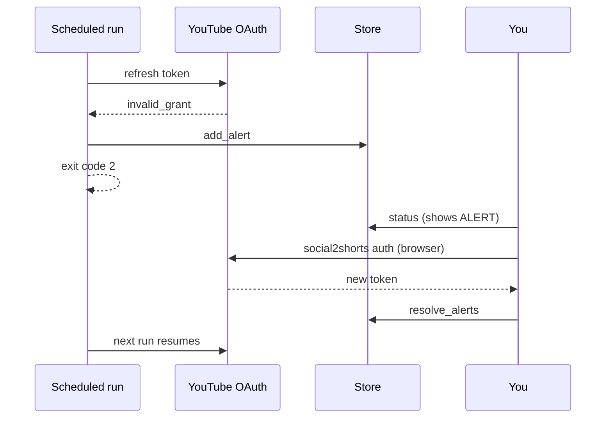

# OAuth expiry and alerts

## What an alert looks like

When the YouTube token is missing or cannot be refreshed, the run stops at once, records an
alert in the database and exits with code **2**:

```text
ALERT: YouTube authorization failed (token refresh failed: invalid_grant ...). Uploads are
paused: run `uv run social2shorts auth` on the PC, then the next run resumes where it stopped.
```

`status` keeps showing it until you fix it:

```bash
uv run social2shorts status
```

```text
ALERT: YouTube authorization failed (...)
```

Unattended runs never open a browser, so a scheduled task cannot hang on a login page.

## Fix it

```bash
uv run social2shorts auth
```

This opens the browser, writes a new `secrets/token.json` and marks every open alert as
resolved. The next run continues where the last one stopped: nothing was lost, because each
upload is written to the ledger right after YouTube returns.



## Common causes

| Cause | Fix |
|---|---|
| Consent screen still in **Testing**: refresh tokens expire after 7 days. | Publish the app to **In production**, then `auth`. |
| You revoked access in your Google account security settings. | `auth` |
| `secrets/token.json` deleted or corrupt. | `auth` |
| `client_secret.json` missing. `auth` says so and exits 1. | Download it again from *Credentials*. |

## Other stops that are not alerts

These end a run early with a yellow "Stopped early" line and exit code 0:

- `daily YouTube quota spent (...)`: the next run after midnight Pacific continues.
- `YouTube reports today's quota is spent`: YouTube said `quotaExceeded` first.
- `publication schedule is full`: no free slot in the next 400 days.

A failed upload is retried with exponential backoff and jitter (up to 8 retries on 5xx
errors and dropped connections) before it counts as a failed attempt.
