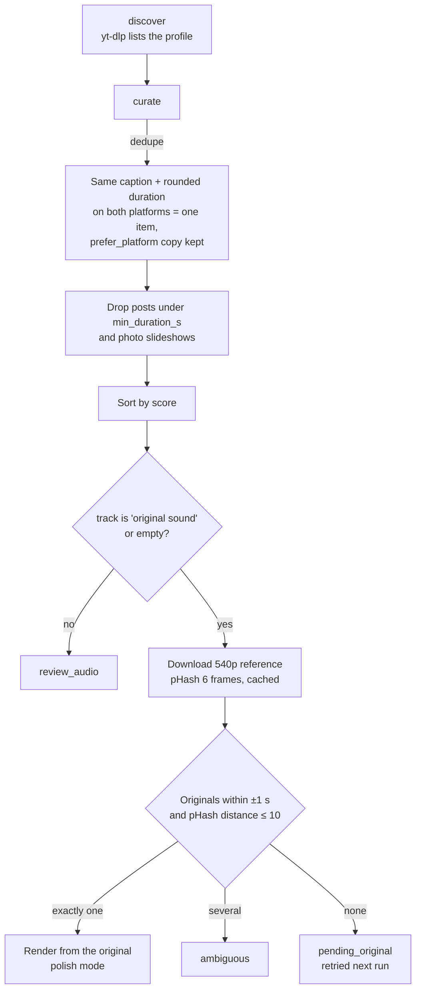

# Backlog of best TikTok / Instagram posts

You already published a lot on TikTok and Instagram. You want the best of it on YouTube, in
the original phone quality, not the 540p copies the platforms serve.

## Commands

```bash
uv run social2shorts discover                    # list posts into the catalog
uv run social2shorts curate --top 30             # see the shortlist and its order
uv run social2shorts ingest                      # copy phone originals (Windows, phone plugged in)
uv run social2shorts run --source catalog --dry-run --limit 3
uv run social2shorts run --source catalog --limit 3
```

`discover --limit N` caps posts per platform. `run` also refreshes the catalog itself, so
`discover` is only needed to look at the shortlist before the first run.

## How a post gets in



### The score

`curate` ranks posts with a fixed formula (`curate.py`):

```
score = 1.0 × ln(1 + views)
      + 2.0 × min((likes + 2 × comments) / views, 1)
      + 0.5 if 15 s ≤ duration ≤ 60 s
```

Views dominate. The engagement ratio and the duration bonus break ties.

### The match

A post matches an original when the durations differ by at most `duration_tol_s` (1.0 s)
and the smallest Hamming distance between any pair of frame pHashes is at most
`phash_threshold` (10). Fingerprints of originals are cached by path and file size, and the
reference pHashes per post are cached too, so a post waiting for its original is never
downloaded twice.

Exactly one candidate is required. Several candidates (a series filmed the same night) go to
review: the tool never guesses.

### Polish mode

Catalog posts are already edited. The montage engine keeps your cut and only:

- trims a dead head or tail (static, silent, no speech) longer than 0.5 s,
- reframes to 1080×1920, grades, adds captions and the hook line,
- normalizes loudness to -14 LUFS and adds a progress bar.

## Tips

- Plug the phone in before the run, or run `ingest` first. Posts without an original stay
  `pending_original` and are retried every run.
- Licensed tracks never upload on their own. See [Review queue](review-queue.md).
- Instagram usually needs a cookies file exported from a logged-in browser:
  `[sources] instagram_cookies = "cookies.txt"`.
