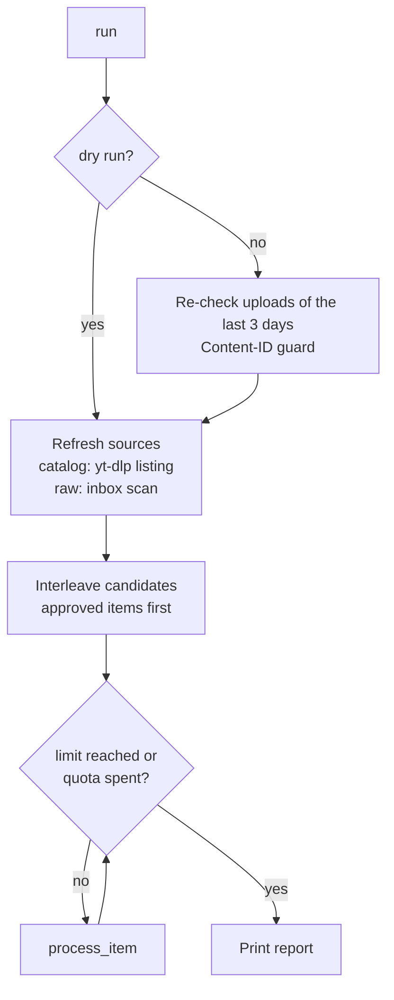

# Use cases

Each page is one job, with the exact commands. They all assume `config.toml` in the current
folder. Pass `-c path/to/config.toml` to use another one.

| I want to... | Page |
|---|---|
| Publish my best TikTok / Instagram posts in phone quality | [Backlog of best posts](catalog-backlog.md) |
| Turn 200+ raw clips into Shorts automatically | [Raw inbox to AI montage](raw-inbox.md) |
| Let it run on its own every few hours | [Scheduled runs on Windows](scheduled-runs.md) |
| Handle licensed music, ambiguous matches and failures | [Review queue](review-queue.md) |
| Go from unlisted to public, or spread uploads over weeks | [Publishing and quota](publishing.md) |
| See what a Short will look like before uploading | [Dry run previews](dry-run.md) |
| Fix an expired login or an alert | [OAuth expiry and alerts](alerts.md) |
| Plug in a new platform or input | [Adding a source](new-source.md) |

## What one run does

`--source all` (the default) alternates one catalog item and one raw item.
