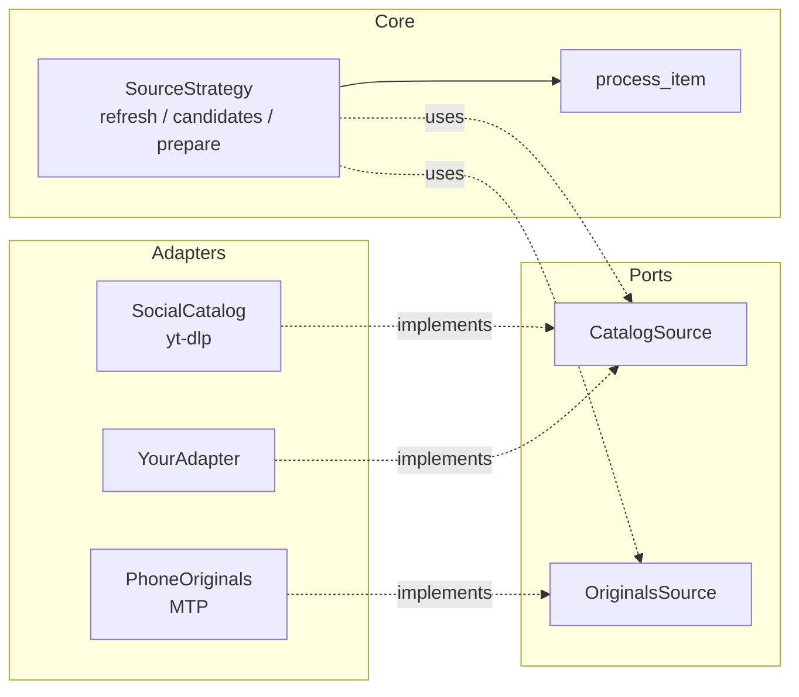

# Adding a new source

The pipeline core only knows *ports* (`typing.Protocol` interfaces in `ports.py`) and *source
strategies* (in `pipeline.py`). Adding a source means writing an adapter for a port, or a new
strategy, or both. The core loop stays untouched.



## Case 1: another platform for already-published posts

Say you want YouTube long-form, or another site yt-dlp supports, as a catalog source.
Implement `CatalogSource`:

```python
from pathlib import Path

from social2shorts.models import CatalogEntry, Platform


class MySiteCatalog:
    """CatalogSource adapter for my-site."""

    def discover(self) -> list[CatalogEntry]:
        return [
            CatalogEntry(
                platform=Platform.tiktok,  # add a member to Platform for a real new platform
                source_id="abc123",
                url="https://my-site.example/v/abc123",
                caption="Night ride on the coast road",
                duration=34.0,
                view_count=1200, like_count=90, comment_count=4,
                upload_date="20261020", track="", artist="",
            )
        ]

    def download_reference(self, url: str, dest_dir: Path) -> Path:
        ...  # download a low-res copy for pHash matching, return its path
```

Then wire it in `PipelineDeps.default()` (`pipeline.py`), for example by combining it with
`SocialCatalog`. Everything after discovery (curation, audio gate, matching, rendering, upload)
works unchanged. If you add a `Platform` member, `prefer_platform` accepts it too.

## Case 2: a new kind of input

For input that is neither a published post nor an inbox file (a GoPro SD card, a NAS share),
add a `SourceKind` and a strategy:

```python
class GoProStrategy:
    kind = SourceKind.gopro            # new member in models.SourceKind

    def refresh(self, run: Run) -> None:
        """Register new files as items (store.upsert_raw works for file-based input)."""

    def candidates(self, run: Run) -> list[Item]:
        """Items to try this run, approved ones first."""

    def prepare(self, run: Run, item: Item) -> Source | None:
        """Source(path, MontageMode.highlight), or None after routing to review/pending."""
```

Register it in `STRATEGIES` and add the value to `SourceChoice` so `run --source gopro`
works. `process_item` handles dedupe (item key and source-file sha256), transcription,
metadata, rendering, upload, ledger and guard for every kind.

## Checklist

- [ ] The adapter satisfies the port's method signatures (structural typing: no base class).
- [ ] A fake in `tests/fakes.py` and tests that run without network or ffmpeg.
- [ ] A stable `key`. Re-uploads of the same file are blocked by its sha256 in any case.
- [ ] New config keys documented in [Configuration](../configuration.md).
- [ ] Any schema change goes through a new function appended to `db.MIGRATIONS`.
