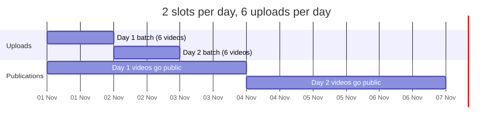

# Publishing and quota

## Unlisted first, then public

The default upload privacy is `unlisted` (`[youtube] default_privacy`). Watch the first
uploads, then make them public:

```bash
uv run social2shorts run --limit 3                    # unlisted
uv run social2shorts status                           # list what was uploaded
uv run social2shorts publish 7667654234271255828 --privacy public
uv run social2shorts publish all --privacy public
uv run social2shorts publish raw-0f3a9c1d2b4e5f60 --privacy private
```

`--privacy` is required: `public`, `unlisted` or `private`. Each change is a `videos.update`
call costing 50 units. When the day's quota runs out, the remaining items are reported as
failed with "daily quota spent, retry tomorrow". The command exits with code 1 if anything
failed.

Two kinds of uploads are left unchanged unless you ask, and listed as *left unchanged*:

| Upload | Why it is skipped | Include it with |
|---|---|---|
| Made private by the Content-ID guard (`claimed`) | You should check Studio first | `--include-claimed` |
| Scheduled, `publishAt` still in the future | Changing it clears `publishAt` and breaks the calendar | `--include-scheduled` |

```bash
uv run social2shorts publish 7667654234271255828 --privacy public --include-claimed
```

## Scheduled publication

```bash
uv run social2shorts run --privacy scheduled --continuous
uv run social2shorts schedule --count 10
```

With `scheduled`, each video is uploaded `private` with `publishAt` set to the next free slot.
YouTube makes it public at that time.

```toml
[schedule]
timezone = "Africa/Casablanca"
publish_slots = ["12:00", "18:00"]   # wall-clock times in timezone
max_per_day = 2
min_lead_minutes = 60                # never schedule closer than this to now
```



How slots are picked (`publish/scheduler.py`):

- Slots are local times in `timezone`, converted to UTC. DST gaps shift forward.
- A day that already holds `max_per_day` publications is skipped. The effective daily cadence
  is `min(max_per_day, len(publish_slots))`.
- A slot must be at least `min_lead_minutes` (≥ 15) in the future.
- The planner looks 400 days ahead. Past that the run stops with "publication schedule is
  full".

!!! warning "Audit required"
    An unaudited API project gets every upload locked to private and `publishAt` dropped.
    Scheduling does nothing until the audit passes. See
    [Getting started](../getting-started.md#3-connect-youtube-oauth).

## Quota planning

Two limits apply. The first one hit stops the run.

| Limit | Config | Default |
|---|---|---|
| API units per day | `daily_quota_units` | 10,000 |
| Units charged per upload | `upload_cost_units` | 1,600 |
| Units for the subtitle track (`captions.insert`) | `upload_captions` | 400 |
| `videos.insert` calls per day | `max_uploads_per_day` | 100 |

Uploads per day = `min(floor(units_left / cost), max_uploads_per_day - uploads_today)`, where
`cost` is `upload_cost_units`, plus 400 when `upload_captions` is on. Days are Pacific-time
days, when Google resets the quota. Other calls also spend units: the guard check costs 1 unit
per 50 videos, and every privacy change costs 50.

For **N uploads per day**, 200 videos take `ceil(200 / N)` days:

| Uploads per day (N) | When | Days for 200 videos |
|---|---|---|
| 5 | default config: `floor(10000 / (1600 + 400))` | 40 |
| 6 | `upload_captions = false`: `floor(10000 / 1600)` | 34 |
| 2 | you cap runs with `--limit 2` | 100 |
| 1 | `--limit 1` | 200 |
| 100 | `upload_cost_units = 100` (current cost, see below) | 2 |

Publication follows the schedule, not the upload rate. With the default 2 slots a day, 200
scheduled videos go public over **100 days**, even if uploading finished on day 40.

!!! tip "Check your real numbers"
    Google has changed upload pricing: the research notes in this site report that
    `videos.insert` dropped to about 100 units in December 2025 and got its own bucket of
    100 calls per day in June 2026. The defaults here stay conservative. Look at *Cloud console
    → APIs & Services → YouTube Data API v3 → Quotas* and set `upload_cost_units` to match.

`status` shows what is left today:

```text
Quota today (Pacific): 4800/10000 units used, room for 3 more upload(s).
```

If YouTube answers `quotaExceeded` before our own count does, the day is marked spent and the
run stops cleanly. The next run after midnight Pacific continues.
