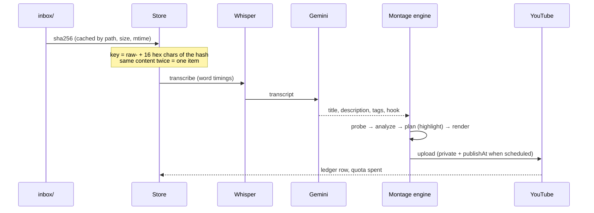

# Raw inbox to AI montage

You have 200+ raw clips that were never published. You want each one turned into a short,
watchable highlight without editing them by hand.

## Commands

```bash
# 1. Drop the files in the inbox (sub-folders are fine)
cp /path/to/rides/*.mp4 inbox/

# 2. Preview a few renders
uv run social2shorts run --source raw --dry-run --limit 5

# 3. Upload a first batch for review
uv run social2shorts run --source raw --limit 3

# 4. Then let it fill a publishing calendar until today's quota is spent
uv run social2shorts run --source raw --privacy scheduled --continuous
```

Accepted extensions: `.mp4 .mov .m4v .mkv .3gp`.

## What happens to each clip



- **Dedupe.** A file is keyed by its content hash. Renaming or moving it keeps the same item;
  an exact copy is skipped.
- **Highlight mode.** The engine scores every 0.2 s of the clip (motion, loudness, speech,
  engine revs), pulls the best 2 s to the front as a hook, fills about 35 s with the best
  segments in chronological order, and ends on an energy peak that crossfades back into the
  first frame. Details: [AI montage engine](../montage.md).
- **Variation.** Each clip gets its own caption colour, caption and hook height, cutting
  rhythm and zoom strength, seeded from its content. 200 Shorts don't share one template.

## Tune the result

```toml
[montage]
target_duration_s = 35   # 15-45 s is a good range for POV
hook_s = 2.0             # 0 disables the hook
captions = "karaoke"     # karaoke | minimal | none
reframe = "smart"        # smart | blur | crop | pad
music_dir = "music"      # optional: royalty-free tracks only
```

!!! warning "Do not move files out of the inbox during a run"
    A registered file that disappears fails with `FileNotFoundError`. After three failures
    it goes to the review queue.

## How long will 200 clips take?

With the default quota settings, about 6 uploads per day, so **34 days** of runs. With
`--privacy scheduled` and two publish slots a day, the public calendar spans **100 days**.
See [Publishing and quota](publishing.md).
