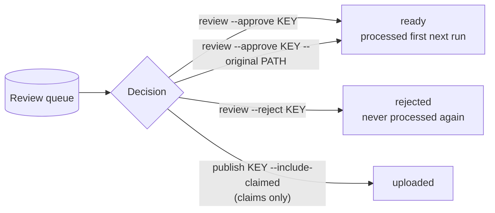

# Review queue

Some decisions need a human. The pipeline never guesses on them: it parks the item, tells you
why, and moves on to the next one.

```bash
uv run social2shorts review
```

```text
                 Waiting for you (3)
 item                 kind       what to do                                     since
 7667654234271255828  audio      licensed music (Song - Artist). If you own ... 2026-10-23 09:12:01
 7667612345678901234  ambiguous  2 phone originals look like this post. Pick... 2026-10-23 09:14:40
 raw-0f3a9c1d2b4e5f60 error      gave up after 3 attempts: MontageError: ...    2026-10-23 10:02:13
```

## The six kinds

| Kind | Why it's here | What to do |
|---|---|---|
| `audio` | The catalog post uses a licensed track (yt-dlp `track` is not "original sound"). | If you own the rights or it is royalty-free: `review --approve KEY`. Otherwise `review --reject KEY`. |
| `ambiguous` | Several phone originals match the post. | Pick one: `review --approve KEY --original PATH`. The candidate paths are printed if you omit `--original`. |
| `error` | Processing failed 3 times. | Fix the cause (file moved, ffmpeg error...), then `review --approve KEY` for a fresh retry budget. |
| `short` | A raw clip is shorter than `min_duration_s` (12 s). | Render it anyway: `review --approve KEY`. Or `review --reject KEY`. |
| `interrupted` | A previous run died while uploading this video. It may or may not be on YouTube. | Look in YouTube Studio. If it is there: `review --reject KEY`. If not: `review --approve KEY`. |
| `claim` | The Content-ID guard made an uploaded video private. | Check YouTube Studio. If it's fine: `publish KEY --privacy public --include-claimed`. If not: `review --reject KEY`. |



## Commands

```bash
# Licensed music you have the rights to
uv run social2shorts review --approve 7667654234271255828

# Ambiguous match: choose the original
uv run social2shorts review --approve 7667612345678901234 --original originals/VID_20260412_bsl.mp4

# Failure fixed: retry
uv run social2shorts review --approve raw-0f3a9c1d2b4e5f60

# Never upload this one
uv run social2shorts review --reject raw-0f3a9c1d2b4e5f60
```

Approving an item:

- sets its status to `ready` and resets its attempt counter,
- removes it from the queue,
- and makes it the first candidate of the next run (approved catalog items skip the music
  gate, approved raw clips skip the length check).

Approving an item that is already on YouTube only clears the review row and reminds you to use
`publish` to change its visibility.

## Failures before the queue

A failure does not go to the queue at once. The item is counted, marked `failed` and retried on
the next runs. On the third failure (`MAX_ATTEMPTS = 3`) it is queued as `error`. The run
report shows retries under *failed (will retry)*.

When 3 videos in a row fail with the *same* error, the run assumes the problem is the system
(network down, ffmpeg missing, model download failed), not the videos. It stops, records an
alert, and charges no attempt to any of them. Fix the cause and run again.
