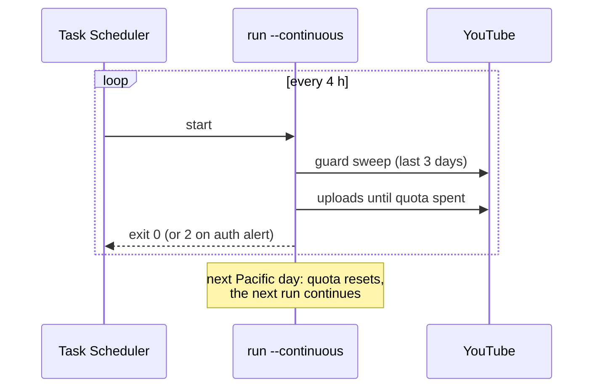

# Scheduled runs on Windows

You want the PC to process new catalog posts and inbox clips on its own, every few hours,
and stop cleanly when the day's quota is spent.

## Register the task

```powershell
# From the repo, in PowerShell
.\scripts\scheduled_run.ps1
```

If PowerShell blocks scripts:

```powershell
powershell -ExecutionPolicy Bypass -File .\scripts\scheduled_run.ps1
```

| Parameter | Default | Meaning |
|---|---|---|
| `-TaskName` | `social2shorts` | Name in Task Scheduler |
| `-EveryHours` | `4` | Repeat interval |
| `-Source` | `all` | `catalog`, `raw` or `all` |
| `-Privacy` | `scheduled` | `public`, `unlisted`, `private` or `scheduled` |
| `-Config` | `config.toml` | Config file, relative to the repo |
| `-Unregister` | | Remove the task |

Examples:

```powershell
.\scripts\scheduled_run.ps1 -EveryHours 6 -Privacy unlisted -Source raw
.\scripts\scheduled_run.ps1 -Unregister
```

## What the task runs

```text
cmd /c "uv" run social2shorts run --continuous --source all --privacy scheduled -c "config.toml"
      >> logs\social2shorts.log 2>&1
```

- `--continuous` removes the `--limit` cap: the run uploads until the quota is spent.
- First trigger is 5 minutes after midnight of the registration day, then every
  `-EveryHours`. `StartWhenAvailable` catches up on missed runs.
- `MultipleInstances IgnoreNew`: a run never overlaps the previous one.
- A run is stopped after 3 hours.
- Output, including alerts, goes to `logs\social2shorts.log`.



## Notes

- The task is registered for the current user without a stored password, so it runs while
  you are logged on. Change the task's security options in Task Scheduler if you need it to
  run logged off.
- The PC must be awake. Set the power plan so it does not sleep during runs, or tick
  *Wake the computer to run this task*.
- The phone does not need to be plugged in. Without it, catalog posts use the cached
  originals; new posts wait in `pending_original`.
- Unattended runs never open a browser. If the YouTube token stops working the run exits
  with code 2 and leaves an alert. See [OAuth expiry and alerts](alerts.md).
- Check progress any time with `uv run social2shorts status`.

Other OS: run the same command from cron or a systemd timer, for example
`0 */4 * * * cd /path/to/social2shorts && uv run social2shorts run --continuous --privacy scheduled >> logs/social2shorts.log 2>&1`.
