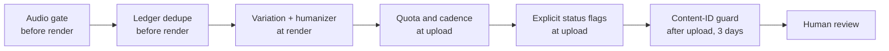

# YouTube and monetization safety

The worst outcome is not a failed upload. It is a channel flagged as inauthentic, a copyright
claim, or 200 duplicates. This page lists every safeguard in the code, and what each one
cannot do.

## Audio gate (catalog)

yt-dlp reports the sound used by each post. If `track` is anything other than empty,
"original sound" or "son original", the post goes to review as `audio` and is never uploaded
without `review --approve`.

**Limits.** It trusts platform metadata. Music mixed into a video labelled "original sound"
passes the gate. Raw inbox clips have no metadata, so they skip it. The Content-ID guard is
the second line.

## No duplicates

- Catalog: the fingerprint is a hash of the normalized caption and the rounded duration, so the
  TikTok and Instagram copies of one reel are one item.
- Raw: the fingerprint is the file's sha256.
- The ledger row is written right after YouTube returns, before anything else can fail. Every
  item is checked against the ledger before rendering. A rerun never uploads the same content
  twice.

**Limits.** Two catalog posts with the same caption and duration are treated as one. A
re-encoded copy of a raw file has a new sha256 and counts as new content.

## Content-ID guard

The public Data API has no claims endpoint: real Content ID claims are only visible in YouTube
Studio or to CMS partners. The guard checks what `videos.list(part=status,contentDetails)`
does expose:

| Signal | Reason recorded |
|---|---|
| `uploadStatus = rejected` | `rejected: <rejectionReason>` |
| `uploadStatus = failed` | `failed: <failureReason>` |
| `regionRestriction.blocked` not empty (the usual effect of a music claim) | `blocked in N countries` |
| `licensedContent = true` | `claimed as licensed content` |
| The video is gone | `removed by YouTube` |

A flagged video is made private, its item becomes `claimed`, and a `claim` review is queued.
The check runs right after each upload and again at the start of every real run for uploads of
the last 3 days that are public, unlisted or scheduled, because claims show up minutes to
hours later. It costs 1 unit per 50 videos.

**Limits.** A claim that only monetizes (no blocking) is invisible here. `licensedContent` is
also true for content you own and registered. YouTube Studio stays the source of truth. A guard
error (other than auth) is logged and retried on the next run.

## Variation and the humanizer

YouTube's "inauthentic content" policy targets mass-produced content "made with a template
with little to no variation across videos", channel-wide. Mitigations in the code:

- **Visual variation** per source file: caption accent, caption and hook positions, cutting
  rhythm, zoom strength, music track. See [montage variation](montage.md#per-video-variation).
- **Content-driven edits**: the highlight plan depends on each clip's own motion, sound and
  speech.
- **Metadata from the video itself**: Gemini writes from the caption and transcript, in a
  first-person rider voice, with banned clichés listed in the prompt.
- **`humanize()`** then rewrites what slips through: "unleash", "epic journey", "dive into",
  "elevate", "ultimate", "breathtaking", "adrenaline-fueled", "you won't believe",
  "must-see". It keeps at most 2 emojis (none in the hook), turns ALL-CAPS words into
  Capitalized ones and collapses repeated punctuation.
- **Cleaning**: @handles, hashtags in the text, and TikTok/Instagram/Reels mentions are
  stripped. Spam tags (`fyp`, `foryou`, `viral`, `pourtoi`...) are dropped.
- **Varied endings**: a call-to-action line is picked per item from a list (some items get
  none). Without Gemini, fallback titles are picked per item too.
- **Limits**: title ≤ 100 characters, hook ≤ 40, 15 tags and ≤ 450 tag characters.
  `#Shorts` is appended to the description.

**Limits.** This lowers the template signal; it does not guarantee monetization. Variation is
still within one caption style and one structure per mode. See the [roadmap](roadmap.md).

## Quota and daily caps

`QuotaBudget` tracks units and `videos.insert` calls per Pacific day in the database. A run
stops before an upload that would not fit, and marks the day spent if YouTube answers
`quotaExceeded` first. With `--privacy scheduled`, uploads become a steady publishing calendar
(`max_per_day`, default 2) instead of bursts. See [Publishing and quota](use-cases/publishing.md).

## The API audit

Unaudited API projects get every upload locked to private. The pipeline compares what YouTube
applied with what it asked for, logs a warning, and stores the real privacy. Request the
compliance audit early. It is also how you get more quota.

## Status flags on every upload

| Field | Source |
|---|---|
| `status.privacyStatus` | `--privacy` / `default_privacy` (`private` when scheduled) |
| `status.publishAt` | next free slot, when scheduled |
| `status.selfDeclaredMadeForKids` | `[youtube] made_for_kids` |
| `status.containsSyntheticMedia` | `[youtube] contains_synthetic_media` |
| `snippet.categoryId` | `[youtube] category_id` |
| `snippet.defaultLanguage`, `defaultAudioLanguage` | `[youtube] language` |

`containsSyntheticMedia` is the altered or synthetic content disclosure. It is needed for
*realistic* generated or altered content (face swaps, synthetic voices, fake events). Crops,
zooms, speed ramps, colour grading, captions and AI-written titles do not need it, so the
default is `false`. Set it to `true` if you ever add generated scenery or an AI voice.

## Human in the loop

- First uploads default to `unlisted`.
- Licensed music, ambiguous matches, repeated failures and claims all wait in the review
  queue.
- OAuth problems stop the run and leave an alert; nothing runs half-authorized.
